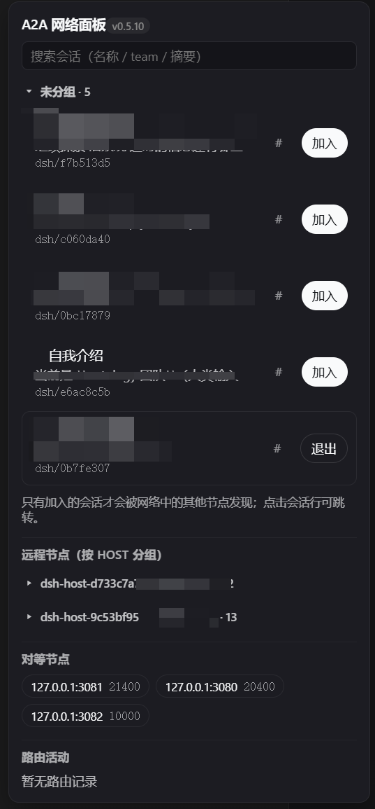
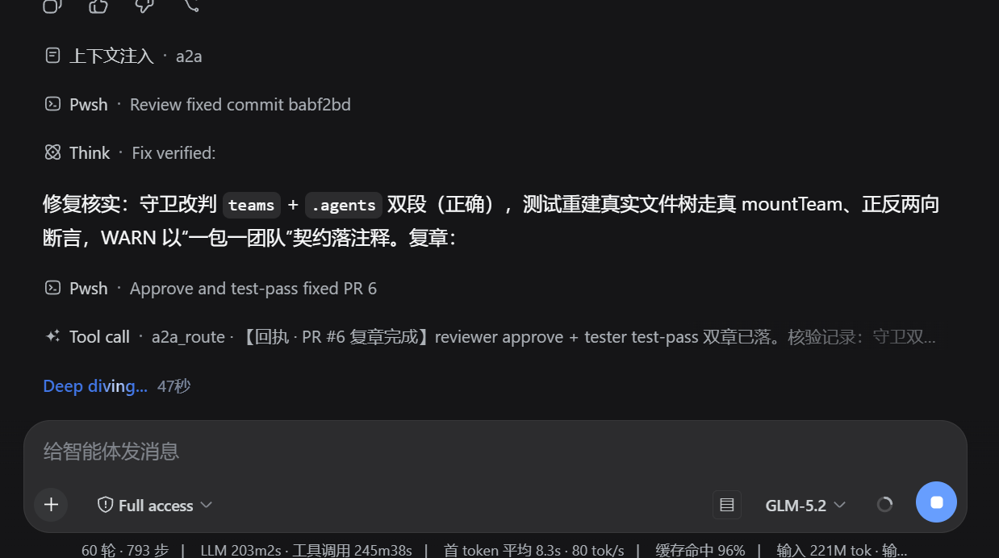

# @nelsonlongxiang/dsh-open-a2a-net

English | [中文](README_zh.md)

[](https://www.npmjs.com/package/@nelsonlongxiang/dsh-open-a2a-net)

Open A2A network plugin for [DeepSeek Harness](https://github.com/deepseek-ai/deepseek-harness) (DSH): turns a DSH
deployment into one node of a decentralized agent network — no central server, no registry.

Each node publishes a **signed, expiring agent card** at `/.well-known/agent-card.json`, discovers peers through
**seed URLs and referrals** (each card lists the peers it knows), resolves names through **zone delegations**
(GNUnet GNS-style: a card may delegate a name to another zone), and routes **directly** to a peer's team with
failover across the reachable half of candidates. Every main session can additionally be exposed as a **session
node** other hosts can discover and join from the web sidebar.

| The sidebar network panel | Context message display |
| --- | --- |
|  |  |

## Install

```sh
dsh plugin --profile web add @nelsonlongxiang/dsh-open-a2a-net
```

Restart `dsh web`, then open the sidebar network panel (footer action).

(As a package name, a local path, or a Git URL; the argument is handed to pnpm unchanged. The package's `prepare`
script is `pnpm build`, but only a Git URL install triggers it, and pnpm 11 blocks a Git package's build script:
`dsh plugin` reports an error that prints the exact key — add it under `allowBuilds` in the profile's
`pnpm-workspace.yaml` and run it again. A package installed from the registry already ships its build output and
does not build; a local-path install does not build either, so run `pnpm build` in that directory first. Building
needs pnpm >=11.24 and <12 (`engines` in `package.json`). A standalone Git install outside a DSH profile can now
build (the `@deepseek-ai/*` peers come from npm; verified on 0.7.0), so it no longer has to be limited to a registry
or profile install.) The plugin composes beside the stock webserver row: it registers the state and control routes
(`/__dsh_a2a/*`, while `sessionNodes` is on — the default) on the shared listener and its model tools on the shared
tool runtime; the card route `/.well-known/agent-card.json` is registered only when `announce: true` (off by default).

## What you get

- **Model tools** (twelve, see the table below) — `a2a_teams` lists the teams this node can see (its own rows
  plus peer teams inside the joined-team scope); `a2a_route`
  sends one message to a team, reuses `context_id` to continue a remote conversation, and fails over across
  candidates when a peer is unreachable. `a2a_tasks` reconciles the receipt contract across three tiers: every route that leaves a
  task owed a reply (async delivery, or a synchronous wait released at its 180s deadline; a synchronous wait the caller aborts is not booked,
  and a delivery with no routable callback address is only listed as a visible row with no receipt debt) stays in the owed book as pending until its
  `[A2A receipt] task <task_id>` message correlates — overdue rows auto-dead-letter past the stale TTL (a revived target can still
  settle with a late receipt), every settlement lands in the bounded archive instead of being silently evicted, and each row keeps
  its follow-up `context_id`, persisted across
  restarts. `a2a_probe` measures the tracked fleet's reachability and round-trip latency (one verified-card
  fetch per peer, optionally narrowed to a single url) for pre-dispatch health checks, naming each miss's
  stage — `unreachable` (transport/HTTP) vs. `rejected` (distrusted card).
- **Sidebar panel** — the footer entry in the web sidebar, slimmed down to this host's recent network activity
  (`docs/design/panel-activity-feed.md`): in-flight routes, owed receipts (only settleable debt is listed; the stale conversational tail is
  only counted) and the routing activity ring side by side, so a cross-turn wait is visible without asking the model; an activity row for a
  same-host session jumps to that session inside the GUI; an unread badge for inbound activity, the package version badge in the title, and an entry
  to the workbench. Joining/leaving the network, canvas teams and member arrangement are no longer done in the sidebar — they moved to the
  workbench planning board below. Session teams are `<team>/<id8>`; web sessions use their id's first 8 chars (after dropping the `session-`
  prefix), imported sessions (`import-<uuid>`) keep the `import-` prefix plus the uuid's first 8 hex chars so imported ids cannot collapse into a
  handful of teams.
- **Archive leaves the network** — archiving a session (workspace registry state) takes it off the node network: its node is unmounted,
  its roster declarations withdrawn, it is hidden from listings and the card, and it is never woken — at boot settlement before any wake, on every
  state read (a mid-session archive disappears within one state poll), and as a route-time guard. **The join intent is kept** in `joined.json`
  (wiping it on a transient archived reading once left cold sessions that could never wake again); the prune is recorded as `archive-prune` in the
  state face's `registry.teamAudit`.
- **Honest waits** — a synchronous route whose target never answers: for a same-host session target the caller is released at a 180s
  reply-wait deadline with the delivered shape (`TASK_STATE_DELIVERED`) and the receipt contract (the target answers on its own cadence); a remote
  peer reached over the direct route is bound by a 15s transport budget, then the host tries to recover the peer's settled outcome through the task
  query (upgrading to the real result if it finished) and otherwise returns `-32005` "delivered, not settled" — reconcile by task id, do not
  re-dispatch blindly. `async: true` skips the wait entirely. The network panel dims an in-flight row past 120s as a stale wait instead of
  implying live progress.
- **A2A workbench** — `/__dsh_a2a_nexus/`, a full-page DOM workbench (it replaced the Three.js 3D view in 0.6.0; 0.6.2 merged the planning board
  into it: the board is the main stage and Directory / Hosts / Ledger / Activity / Plan ride a collapsible sidebar, plus a Team page when the host
  runs a superagent team; responsive — a wider sidebar from 1440px, a drawer sidebar and bottom-sheet detail up to 1023px, a wrapping header up to
  680px; the panels fall back to the main area when the canvas face goes down). Directory: local sessions (live / cold), canvas teams, remote nodes,
  local logs. Hosts: tracked peers' health and link badges. Ledger: pending / dead letters with in-place clearing. Activity ring. Plan: a derived
  action list plus nudge and dispatch drafting (both produce copyable text). The spatial planning board: build canvas teams, arrange members,
  join/leave the network, with the layout persisted; `?mode=plan` is only an old-link compatibility form — with the canvas face up the board is
  already the default.
- **Announce** — `announce: true` (default `false`; needs a web server in the composition) publishes this node's signed card so peers find it
  without any directory. Referrals (`peers`) go only to a signature-verified caller that is a configured seed or already linked; joined session
  teams (`sessionTeams`), rosters and the canvas org go only to a linked caller; every other caller gets the minimal discovery card (name, team,
  capabilities, records, signature). Unjoined session nodes are not published.

## Model tools at a glance

Twelve tools. With `teamScopeInfo` on (the default), `a2a_teams`, `a2a_status` and `a2a_probe` answer from
this host's joined-team scope: `[this host]` rows plus peers serving a team this host's nodes declared.
`a2a_tasks` (this host's own dispatch ledger) stays unscoped.

| Tool | Answers | Notes |
| --- | --- | --- |
| `a2a_whoami` | Who am I on this network? | The calling session's node id, joined/live state, routable handle, roster + canvas memberships, the owner's `teamJoinAllowlist`, the `teamScopeRouting` switch, and recent refused join/leave attempts. |
| `a2a_teams` | Which teams can I route to? | `[this host]` rows plus in-scope peer teams, with activity excerpts. |
| `a2a_route` | Send a message to a team. | `context_id` continues a conversation; `async: true` delivers without waiting; fails over across candidates. |
| `a2a_tasks` | Which async tasks still owe a receipt? | Three tiers: owed rows keep the follow-up `context_id`; past-TTL rows auto-dead-letter (still settleable); outcomes land in the bounded archive; persisted across restarts. |
| `a2a_probe` | Is the fleet healthy? | One verified-card fetch per in-scope peer (or one given url); `N reachable, M down`; misses classified `unreachable` vs `rejected`. |
| `a2a_team_join` | Declare one joined node a member of a team. | Allowlist-gated: only an **exact** name in `teamJoinAllowlist` authorizes a join (empty list denies every join). A wildcard/prefix entry is shown by `a2a_whoami` but authorizes nothing (`[PATTERN_NO_MINT]`); canvas teams are assigned in the workbench, never here (`[CANVAS_TEAM]`). Attempts land in the state face's `registry.teamAudit`. A model tool may only declare membership for the calling session's own node (else `[NOT_SELF]`), and that node must already be joined (else `[NOT_JOINED]`). |
| `a2a_team_leave` | Retract a team membership. | Not subject to the allowlist — leaving only shrinks exposure; it still can only retract a membership the calling session's own node declared (`[NOT_SELF]`, `[NOT_JOINED]`; nothing to retract if it never declared one). |
| `a2a_exposure` | How visible is this session? | Sets the session's own tier: `linked` (the default floor) or `fleet` (a voluntary opt-up), changeable at any time; requires a joined session. **Today the tier is only persisted (`a2a/exposure.json`) and shown in the `exposure` field of the state face's session rows; it does not yet change what the card or the directory exposes** — "a group's visibility follows its strictest member" is a written rule with neither a group-level API nor an enforcement point in v1 (owner ruling 2026-11-08, #449: documented as is). |
| `a2a_report` | Tell this host's supervision something while off the network. | The one write-ingress to this host that works while unjoined (the read-only `a2a_whoami` is exempt from the join gate too): one-way, lands in the state face's reports ring (newest 64 kept), grants no presence or routing. One report per 30s per session, ≤4000 chars; once the same session has reported the same text 3 times within 10 min, the 4th is refused as a loop. |
| `a2a_status` | What is this node doing right now? | In-scope tracked peers with quality scores, in-flight routes, recent routing activity, and the idempotency window aggregate (occupancy + claim/replay/conflict counters). |
| `a2a_file_send` | Hand files to a team without putting them in a message. | Stages each file (≤16 per call, ≤64 MiB each) on this host, granted to that team for 24 hours, and routes ONE message of `[A2A file]` reference lines; the bytes never ride the message (#91). Needs this host to have published a card URL (`announce`), otherwise it refuses to send. |
| `a2a_file_fetch` | Pull a file someone referenced. | Pulls one `[A2A file]` reference from the host that staged it, carrying this session as `caller_session` and this host node's OriginClaim envelope (a reference naming this host reads the local store directly); checks size and sha256 before saving it under `<cwd>/a2a-inbox/`. A grant names one session (or a whole host, or a canvas team's members); the fetch always marks the session as having read peer content. |

## a2a-net CLI (callers outside a session)

The package also ships a command, `a2a-net` (`bin` → `cli/a2a.mjs`, 0.6.27+), for scripts, terminals
and other agent harnesses that are not a DSH session. It creates its own Ed25519 identity
(`<name>/<16 hex>`), deposits a signed card on one home host for up to 4h (`publish`; an expired deposit
stays listed as an offline row until re-published), and receives into a mailbox on that host (64
entries kept) instead of being woken:

```sh
a2a-net init review-seat --home http://127.0.0.1:3080   # identity + home host
A2A_KEY=... a2a-net publish                              # deposit (key-gated host)
a2a-net route dsh/1a2b3c4d "status?"                     # async by default; --sync waits for the reply
a2a-net inbox --new                                      # unread mail; --wait blocks, --hook feeds a Claude Code hook
```

From 0.6.38, `forwardDirect` defaults to `true`: after a local miss the home can forward an authenticated online CLI one hop to a linked peer target. Both operators must link: A links the receiving B member; B links the CLI handle and explicitly pins A as its home. For canvas targets A links only the owner host (#282 S3, same team authorizes; the owner host must run 0.6.37 or later): receipts are admitted and settle only from receivers frozen from the owner's signed card, on that owner's key. With scope and settlement enforcement on, the member-host auto-receipt settles A’s forwarded row and lands in the CLI inbox; `--sync` returns B’s reply, but on the forwarded path a synchronous wait has only a ~15s transport window and times out with `-32005` (delivered, not settled): the target still auto-receipts when it finishes, so reconcile by task id / `inbox` and do not resend blindly; for long work use the default async `route`, then `inbox --wait --renew`. Commands, flags, environment
variables and exit codes: [`src/skill/references/cli.md`](src/skill/references/cli.md).


### Standalone network node (no DSH instance)

Deployment guide (install, service files, linking DSH hosts, public-internet caveats; Chinese): [docs/guides/standalone-node.md](docs/guides/standalone-node.md).

`a2a-net serve --config node.json` runs the network layer in its own Node process: cards and signatures, the peer directory, CLI deposits and mailboxes, one-hop forwarding, canvas ownership, the ledger, the state face and the workbench. It hosts no AI sessions; a CLI's message for a session is handed to a linked DSH host by the one-hop forwarding rule above. "No DSH instance" means no running DSH host is needed; the runtime still needs the `@deepseek-ai/*` npm packages (when they are missing, `serve` prints the pinned set to install). Run it on a stable machine as the CLIs' home so a DSH restart does not take their deposits, mailboxes and canvas directory down (they also survive the node's own restart). Install and config: the `a2a-net serve` section of [`src/skill/references/cli.md`](src/skill/references/cli.md).

## Canvas teams (arbitrary grouping, v0.5.25)

Peer/member badges are host-specific display facts: bilateral URL seeds or an exact, nonlocal canvas-member handle uniquely advertised by that host card. Shared zone names (such as `dsh`) never establish a badge link. A minimal card without session rows remains unconfirmed/stranger unless bilateral seeds establish the host; this conservative display rule does not change caller admission or CLI home validation.

A canvas team is a user-composed, named, multi-member routing group: **one atomic session node may sit in many teams**, and a route to `<team>/canvas/<name>` resolves the **first live member** (member order is the routing priority) or wakes the **first cold joined member** (wake-on-route). The `canvas/` path segment can never collide with a node alias (`<team>/<id8>`), so both namespaces coexist untouched.

- Storage: `<dsh-home>/a2a/canvas.json` (ordered team entries; caps: 64 teams × 32 members)
- Control API: `POST /__dsh_a2a/canvas` with `action: create | remove | add-member | remove-member`; `cli-home-options` is a read-only owner action for an existing CLI member.
- For a CLI member marked “home 未确定”, open its canvas team inspector and choose “指定 home”. The host freshly reads cards, lists only linked advertisers, and reports unreadable-card counts. No home is selected automatically; confirming calls the existing local `add-member` with explicit `home`, which freshly validates again. A locally held household (live or offline tombstone) instead shows “本机持有，无需指定”, returns `held: true` with no choices, and rejects explicit home writes until that household is revoked. Online local households receive receipts first. A successful local publish removes a conflicting older pin and leaves a durable inspector notice; expiry during local receipt delivery fails closed instead of resolving another advertiser. This does not weaken automatic pinning or admission.
- Membership requires a joined session (live node or remembered intent) — no routing backdoor over unjoined sessions; leaving the network (leave/archive) drops every canvas membership
- A member may also be a **remote** zone-qualified team handle (`zone/a1b2c3d4`) the operator adds by hand — the link that admits that remote caller here and entitles it to the full card
- `a2a_teams` lists local and in-scope remote canvas teams with owner URL and member count; CLI `teams` also includes local canvas and peerOrg, retaining same-name owners as separate rows. `a2a_whoami.teams.canvasDetails` and CLI `whoami --json` list local/remote memberships of this identity (legacy `teams.canvas` stays local-name-only). Owner URLs are discovery metadata, not a requirement to override `--home`. Failure guidance distinguishes visible-directory absence, known-owner missing prerequisites, and multiple owners (candidates, never guessed). Information scope, candidate selection and admission do not change; `/__dsh_a2a/state` serves per-member `joined`/`live` flags for local members and `{ id, team, remote: true }` for remote ones

## Native-teams bridge (node unification, P1) — deprecated

> **Deprecated.** `@nelsonlongxiang/dsh-native-teams` is deprecated. The bridge code still ships
> (`src/teams-bridge.ts`; `nativeTeamsInbound` defaults to `false`), kept for existing deployments;
> new deployments should not rely on it. The section below describes it as it stands.

Two half-bridges to `@nelsonlongxiang/dsh-native-teams` (structural contract mirror: `src/teams-bridge.ts`; the frozen contract lives in that package's `src/a2a-face.ts`):

- **Outbound transport face** — this plugin mounts the `nativeTeamsA2a` service: `resolve` answers through the one directory walk `submit` uses (no drift-prone double matcher), `submit` rides the direct-route dispatcher (per-candidate async gate mirroring `a2a_route`; a peer's idempotency 409 replay is terminal per delivery (async → accepted, sync → throws with the `-32003` literal), never a failover duplicate; accepted submissions track in the owed ledger; when the submitting session is a joined node, its node team rides the wire as the receipt `callback`, so a peer's receipt wakes the session that dispatched the round — wake-on-route covers a cold one; without a joined parent no callback rides and receipts fall back to the caller label), `cancel` drives the cooperative `[A2A cancel]` stop-notice through the wire to the owning team (peers do not track inbound task ids, so a ledger route would always answer unknown) and clears the owed row. It exposes nothing new — only teams the peer network already publishes resolve.
- **Inbound dispatch** (config `nativeTeamsInbound`, default `false`) — a routed team name the sibling registry classifies as an unambiguous local claim starts a routed round through its authoritative seam (`describeTarget`/`startRound`), parented by this node's live initiator, with the A2A envelope riding the round message. Registry presence alone is never exposure: the operator opts in. Dispatcher-level only — inbound callers address the team, never its members (members stay visible-not-addressable). Rounds are bounded like the steer path: a 180s reply-wait deadline (`nativeRoundWaitMs`) answers the honest delivered-unsettled shape while the round keeps going, and the caller's abort (where one exists) cancels the round through its own signal. `wait: false` fires the round detached after prepare-first checks (claim, seam, initiator — a phantom dispatch never answers success); native-teams rounds do not emit A2A receipts in this slice, so their results carry the `bridge` marker and are never booked as receipt-owed (the receipt backflow to `callbackTarget` is the P2 slice).

See `docs/native-teams-bridge.md` for the full mapping and scope notes.

## Configuration

Row config overlays in the profile's patch layers; every key has a schema default.

| Key | Default | Purpose |
| --- | --- | --- |
| `announce` | `false` | Publish this node's agent card for peer discovery. |
| `isolated` | `false` | Send nothing to any peer: card reads, directory sweeps, routes, remote log reads, canvas pings and fleet canvas-op relays are all refused (gh#193). `a2a/peers.json` is left untouched and refused fetches do not score peers; inbound faces keep answering; the state face shows `isolated: true`. For test and acceptance hosts. |
| `forwardDirect` | `true` | From 0.6.38, one-hop forwarding is enabled by default for an authenticated online local CLI after a local target miss; sender scope and the hop guard remain enforced. Link B receiving members at A, and link/pin the CLI home A at B; no second forwarding hop. Set `forwardDirect: false` to restore local-only CLI delivery. |
| `superagent` | `false` | superagent (design v4, team model v5): run superagent's own domain engine (vendored upstream `src/core`) in this host. The team is a canvas team: the owner composes it on the canvas (router and members, local or on other hosts) and binds it at `/__dsh_a2a/superagent` with the router and the allowed senders; its A2A address is the canvas address `<zone>/canvas/<name>`. The router and members run the shipped `superagent-router` / `superagent-member` agent presets; see [`superagent.md`](src/skill/references/superagent.md). |
| `peers` | `[]` | Seed base URLs; referred peers are learned from their cards. |
| `delegates` | `[]` | Zone delegations: `{ name, url, publicKey }` published on the card. |
| `team` | `'dsh'` | Team name this node exposes for direct routing. |
| `session` | `''` | Caller label; `''` derives a stable `dsh-host-<8hex>` per home. |
| `agentName` | `'DeepSeek Harness A2A node'` | Human-facing name on the card. |
| `apiKey` | `''` | `X-API-Key` sent on peer requests; non-empty also gates the control routes. |
| `sessionNodes` | `true` | Expose main sessions as joinable network nodes. |
| `nativeTeamsInbound` | `false` | Dispatch inbound direct routes (and the outbound A2A tools' local candidates) to native-teams registry teams through its routing seam; needs the sibling plugin composed. |
| `nativeRoundWaitMs` | `180000` | Reply-wait budget for one native-teams round (the bridge's deadline, mirroring the steer path's 180s). A round still running past it answers the honest delivered-unsettled shape and keeps going. |
| `wakeJoinedOnBoot` | `false` | Prewarm cold joined sessions' agents after mount (needs the session controller wake face; wake-on-route and the sidebar wake button stay available without it). The prewarm is deferred, foreground-yielding, and cancellable — it never blocks the boot window (see the two knobs below). |
| `wakePrewarmDelayMs` | `10000` | Idle delay between loader settlement and the first prewarm wake; `0` restores fire-at-settle. |
| `wakePrewarmQuietMs` | `5000` | Foreground quiet window: a wake/route demand (or any outbound route in flight) inside this window postpones the next prewarm step; `0` disables the yield. |
| `wakeBootStaggerMs` | `3000` | Pause between serial boot-prewarm wakes (caps log-decode saturation after a restart; wake-on-route never waits on it). |
| `wakeReconcile` | `true` | Continuous desired-state reconciliation: each tick re-derives the cold joined intents due and wakes one per pass (post-boot drift, failed wakes, late gateways). Tuned by `wakeReconcileIntervalMs` (`60000`), `wakeReconcileBackoffBaseMs` (`5000`) and `wakeReconcileMaxBackoffMs` (`600000`). |
| `seatNames` | `{}` | Human-owned stable display labels keyed by full local session id; controls/format characters (Cc/Cf), line/paragraph separators, names without visible content, and address-shaped names (`dsh/66abc2cf`, `zone/canvas/x`) are rejected. Invalid boot entries are dropped individually with warnings; owner writes remain all-or-nothing. Set/clear through the workbench owner panel; labels hot-apply to cards, whoami, CLI teams and the board, without changing titles, handles or admission. A2A model-tool naming arguments are refused. |
| `teamJoinAllowlist` | `[]` | Teams `a2a_team_join` may declare: **exact names only** (a `*`/prefix entry authorizes nothing). Empty denies every join. The owner can also edit it from the workbench owner panel (`/__dsh_a2a/owner-settings`). |
| `teamScopeRouting` | `true` | S3 admission: routing checks caller↔target shared team membership; a session with no declared team has no network. `false` restores the open outbound seam. |
| `teamScopeInfo` | `true` | S5 information-plane scope for `a2a_teams` / `a2a_status` / `a2a_probe` (see the tools section). `false` restores fleet-wide disclosure. |
| `peerAllowlist` | `[]` | Non-empty: a referral is admitted only when its host matches an entry (exact `host[:port]`, bare domain suffix, or full URL). Seeds are never filtered. |
| `referralLearning` | `true` | `false` freezes the tracked set to the configured seeds: referrals are neither learned nor offered. |
| `referralTeamResolution` | `false` | gh#8: team names resolve over seeds + delegates only; `true` restores the legacy whole-store basis (referral-learned peers included). |
| `exposureExcerpt` | `'full'` | How much of a session's activity excerpt the card publishes: `full`, `masked` (shape-only prefix) or `off`. Titles and handles stay. |
| `originClaimWindow` | `true` | OriginClaim transition window: deliveries without an envelope still walk the caller gate (counted as `legacyInbound`); `false` rejects them like failed signatures. |
| `originClaimUrl` | `''` | Override for the envelope's `callerUrl` (pocket-tunneled hosts); `''` derives it. |
| `originClaimUnboundWindow` | `true` | OriginClaim audience-binding window: also sign and accept the legacy envelope that names no audience (accepted ones counted as `unboundInbound`; those whose bound form missed here also as `boundMissInbound`); `false` signs and accepts the audience-bound form only. |
| `canvasLegacyBareMembers` | `true` | #335 migration window: unsuspended historical bare canvas members retain legacy inference; suspended slots never route or authorize. Close only by owner decision after migration and observation. |
| `originClaimAudiences` | `[]` | Extra origins this host answers to as an envelope audience, for port-mapped or proxied hosts whose dialed URL is neither the card URL nor the arrival address. |
| `linkKeys` | `{}` | Link keys (#317): `{ "<peer origin>": "<key>" }`. Requests to that peer carry this key instead of `apiKey`; this host's peer faces (`/a2a/direct`, `/a2a/log`, `/a2a/blob`) accept it only from a caller whose OriginClaim verifies and names that origin (a POST must be Sig3 body-bound); the control routes never accept it. Lets a public node link to the fleet without holding the fleet apiKey; both ends configure the same link key. |
| `gateAgentLessCalls` | `'audit'` | Host-side (agent-less) routing calls: audit them, or `refuse`. |
| `settlementAuth` | `'observe'` | Settlement authorization (#114): `off`, `observe` (record what would be refused, settle as before), or `enforce`. |
| `asyncNudgeDelayMs` | `120000` | Delay before a delivered-but-unconsumed async route re-wakes its target with a one-line nudge; `0` disables. |
| `targetQueueCap` | `3` | At most this many unanswered, receipt-owing tasks queue for one target on this host; the next delivery is refused visibly (`-32009 target-queue-full`, nothing delivered). A receipt for a task this host booked and CLI mailboxes are never refused; a canvas team counts as one target. A refused task id is recorded as failed — retry with a new id. A target-attributed final or its own receipt attempt records `answeredAt` and releases queue capacity even if receipt delivery fails; the row remains owed, with unchanged expiry, late-receipt and conservation semantics. State/board queue counts use this same rule. `0` disables (#224/#253). |
| `taskStaleTtlMs` | `86400000` | Owed-task stale TTL (24h): past it a pending row auto-dead-letters (a late receipt can still settle it). |
| `dshHome` | `''` | DSH home directory override for the plugin's state (`<home>/a2a/…`); `''` resolves the default home. |
| `stageTilesDir` | `''` | Where the office stage finds its licensed tilesets (`office-tileset.png`, `a5-office-floors-walls.png`, `interiors.png`; not shipped, #471), served at `/__dsh_a2a_canvas/tiles/`; `''` is `<home>/a2a/stage-tiles`; missing files draw placeholder tiles. |
| `cardTtlMs` / `flushTimeoutMs` / `routeTimeoutMs` | see schema | Card lifetime (48h) and route timing budgets. |
| `cardCacheTtlMs` / `cardCacheNegativeTtlMs` / `remoteRowsTtlMs` / `stateColdRowsTtlMs` | `60000` / `30000` / `15000` / `5000` | Peer card cache (hit / miss), remote session rows refresh window, and cold-row refresh window of the state face. |

Example — one announcing node with a seed:

```yaml
- id: a2a
  name: '@nelsonlongxiang/dsh-open-a2a-net'
  config:
    announce: true
    peers: ['http://127.0.0.1:41243']
```

## Leave semantics (bounded staleness)

`leave` is a per-session, per-host gesture: it removes the join intent locally and unmounts the node. There is **no network-wide revocation broadcast** — peers keep listing the team until their cached copy of this node's card refreshes (`cardCacheTtlMs`, 60s by default — `sessionTeams` is an unsigned serve-fresh field, so the card's own 48h TTL does not hold it), and inbound deliveries during that window fail honestly (the host no longer resolves the team). A formal revocation-broadcast protocol is tracked in upstream note `2026-08-27-a2a-leave-no-revocation-broadcast.md` (proposed).

## Trust model

Cards are Ed25519-signed and expire; `peers` referrals, `sessionTeams` listings, `lanIp`, and `version` on a card
are unsigned and read fresh — the last two exist so operators can audit which build every fleet node actually runs
without visiting each host. A referral URL whose own fetch just proved it serves this node's card is remembered,
and re-offers of it within a suppression window are ignored instead of flickering in and out of the peer store.
Every `/__dsh_a2a/*` control route — reads included — requires the configured `apiKey` (`X-API-Key`,
constant-time compare) when one is set. With an empty key only a loopback socket is trusted; a
`Sec-Fetch-Site` header can only refuse (a cross-site page is rejected even on loopback), never grant.
Set an `apiKey` before exposing the listener beyond loopback.

| Control route | Purpose |
| --- | --- |
| `GET /__dsh_a2a/state` | The state face the panel and workbench poll (sessions, canvas, peers, remote rows, activity, ledger). |
| `POST /__dsh_a2a/join` · `/leave` | Join or leave one session node. |
| `/__dsh_a2a/canvas` · `/canvas-layout` | Canvas teams (create/remove/add-member/remove-member) and the board layout. |
| `POST /__dsh_a2a/roster-op` | Owner-controlled roster team creation, member add/remove, dissolution, and exact allowlist maintenance. |
| `/__dsh_a2a/groups` | Manual session grouping — deprecated since 0.6.6 (canvas teams supersede it), kept for old panels. |
| `POST /__dsh_a2a/dispatch` | Workbench quick dispatch into a team. |
| `POST /__dsh_a2a/tasks/abandon` · `/tasks/cancel` | Settle an owed task from the caller side (cancel also steers a stop notice to a live local target); the row lands in `archived[]`. |
| `GET`/`POST /__dsh_a2a/superagent` | With `superagent: true`: the engine state (threads, decisions, replies, tickets with stage, the bound canvas and any binding problem), and the owner's actions `settings` (bind `canvas` and `router`) · `request` (the workbench Source) · `serve` (serve another host's team by its canvas id) · `stop` · `retry`. |
| `/__dsh_a2a/session-log` · `/remote-session-log` | Session log reads for the workbench. |
| `/__dsh_a2a/owner-settings` | The owner panel: read (GET) or write (POST) `teamJoinAllowlist`, `teamScopeInfo`, `seatNames` and `announce` into the home patch layer (all but `announce` apply immediately). `seatNames` is a validated full map; omit a session id to clear its label. This owner-authenticated control face is not a model naming tool; local shell/config writers remain inside the existing operator trust boundary. |
| `/__dsh_a2a/fleet-canvas-op` | Relay a canvas operation (`create`, `add-member`, `remove-member`, `remove`) to a peer's `/a2a/canvas-op`, stamped with this node's OriginClaim; the peer's link gate decides. |
| `/__dsh_a2a/cli-deposit` | Deposit, list, revoke and mailbox reads for `a2a-net` CLI identities. |
| `GET /__dsh_a2a/nodes` · `POST` | Node identities (docs/design/node-identity.md): GET reads the roster or one node (`?name=`); POST is an identity write and needs the apiKey even on loopback. |
| `POST /__dsh_a2a/blob` | Stage a file for a recipient (`?to=&name=`) — the file channel's write side; peers pull through `GET /a2a/blob`. |

The state face's ledger: `tasks` (pending, each with `settleable`), `tasksStaleCount`, `tasksDead` (with
`direction` when known), and `archived` — the newest 64 settled rows, newest first, each with `outcome`,
`endedBy` (`receipt` | `echo` | `abandoned` | `cancelled`), `late: true` when a receipt arrived after the
caller ended it, and `direction` when known — plus `archivedCount` and `archivedSplit` (count per outcome).

## Stages (visualization surfaces)

Two full-page stages mount beside the model tools: `/__dsh_a2a_nexus` (the
A2A workbench — since 0.6.2 the 2D spatial planning board IS the stage and
the directory/ledger/activity/plan panels ride a collapsible side rail in
one merged, responsive shell; while the canvas face is down the panels fall
back to the main stack; the Three.js topology viewer was retired in 0.6.0;
`?mode=plan` still converges on the board) and `/__dsh_a2a_canvas`. A bare
mount path
redirects (301) onto its trailing-slash form, so both spellings render and
the shell's relative assets always resolve inside the served tree. For
offline development, `nexus-stage/scripts/mockhost.py [port]` serves the
built stage with canned state; open `/?fault=500` on it to exercise the
on-page fault badge. `pnpm verify` needs no manual bootstrap on a fresh
checkout: its `verify:nexus` step installs the subpackage dependencies
itself before building.

## Collaboration SOP (network practice, v0.1)

> Current rules: the A2A collaboration norm ([`src/skill/references/collaboration.md`](src/skill/references/collaboration.md), in Chinese, shipped with the plugin to every node). The v0.1 SOP below is kept as history; where they conflict, the norm wins.

Distilled from the 0.1.x–0.5.x delivery cycles by the network's research node; adopted by the maintainer.

- **Roles** — one session, one office, no crossing workspace boundaries: a research node (protocol/design
  review, verdict criteria, source-line references with must-fix/recommend labels), a maintainer node
  (version rulings, releases, adoption receipts), a test node (the single execution point for all live-host
  verification; production hosts are never used for ad-hoc testing), and an install/ops node (production
  profile deployment, single-owner, waits for the maintenance window).
- **Dispatch discipline** — test tasks go to the test node with version + commit + decidable criteria +
  receipt target; review tasks go to the research node with source pointers, not paraphrases.
- **Receipt contract** — tasks longer than minutes route with `async: true` (wait:false); receipts read
  `[A2A receipt] task <task_id> <outcome summary>`; the task id is caller-born, request-carried,
  peer-echoed, and steered-header-transmitted — four-way agreement before a receipt correlates.
- **Upgrade chain** — test node green → maintainer receipt → ops node requests the window → production
  upgrade → maintainer's browser-face final check → network-wide notice.
- **Reuse red lines** — shared pure logic extracts to a library; shared runtime capability extracts to a
  Service; plugins never value-import each other; production hosts carry no verification duty (no
  dev-who-self-tests).

## Verify

Tests are layered by depth (contract: `docs/testing-layers.md`): each layer
has its own directory and script, so iteration can target one depth.

```sh
pnpm install       # auto-install-peers pulls the DSH peer train from npm
pnpm verify        # typecheck + build + ALL vitest layers below + layout gate + nexus-stage suite
pnpm test:unit     # L0 — pure logic, no fiber, no sockets (stores, codecs, jsdom components)
pnpm test:wire     # L1 — ONE real plugin instance over real HTTP against faked peers
pnpm test:mesh     # L2 — >=2 REAL nodes (own homes/keys/peers.json) over real HTTP: the
                   #     cross-machine equivalent, incl. fault injection (clock-skew cards,
                   #     tampered cards, partition/restart, alias collapse, zone delegation,
                   #     referral freeze) and receipt replay — see the fault matrix in
                   #     docs/testing-layers.md
pnpm test:live     # L4 — REAL remote machines, env-gated (DSH_A2A_LIVE_MESH=...); skipped
                   #     by default, never in CI — runbook in docs/testing-layers.md
pnpm build         # host lib (including lib/a2a-client.js), client types, and browser bundle (lib/client.js)
```

## Non-DSH interop (protocol modules)

A node that is NOT a DeepSeek Harness host can still speak the protocol. The
four dependency-free protocol modules are exported subpaths (gh#13) — import
them without pulling the DSH peer train:

```js
import { signCard, verifyCard } from '@nelsonlongxiang/dsh-open-a2a-net/card'
import { formatReceipt, parseReceipt } from '@nelsonlongxiang/dsh-open-a2a-net/receipt'
import { withinRouteBodyCap } from '@nelsonlongxiang/dsh-open-a2a-net/transport-caps'
import { A2aClient } from '@nelsonlongxiang/dsh-open-a2a-net/a2a-client'
```

Implement your own signed card, `GET /.well-known/agent-card.json`, and
`POST /a2a/direct`. The wire shapes these modules encode are the contract.
Anonymous card fetches get the minimal discovery face **without `peers`** (#312). The referral list requires a verified OriginClaim **and** either a caller URL explicitly seeded by this host (origin match, exact mount for path-prefixed claims) or an existing operator link. An unrelated self-signed stranger gets no topology; a configured seed may obtain referrals before a bilateral full-card link exists. Session/roster/organization fields still require the full-card link gate. Signed `?discovery=1` requests explicitly ask for only core plus referrals, avoiding recursive full-card bootstrapping. Anonymous-only legacy crawlers must use explicit seeds (or upgrade to signed requests); missing `peers` remains a valid signed card and delegations are unchanged. The full card needs a
verified OriginClaim envelope (`X-A2A-Caller` / `-Url` / `-Ts` / `-Sig`,
signed with your own card key) **and** a link to the serving host: your card
URL shares its origin, your handle is one of its joined session handles, its
operator added your exact handle as a canvas remote member, or both operators
seeded each other (its `peers` names your origin and your card's `peers` names
its origin). A verified but unlinked caller still gets the minimal card. See
`docs/protocol/delivery-origin-auth.md` and the rest of `docs/protocol/` for
the envelope details.

**Which artifact to build against.** npm direct install already includes the
four subpaths: releases from 0.6.25 (badge `latest`) carry them, so
`npm install @nelsonlongxiang/dsh-open-a2a-net` works out of the box —
see `examples/external-node/` for a runnable external-node example that
exercises all four subpaths against an embedded mock peer. The subpath
exports landed in commit `9cb3852`; versions before that (public 0.5.15
included) predate the admission rules and the OriginClaim envelope above,
and importing the subpaths from them fails with
`ERR_PACKAGE_PATH_NOT_EXPORTED` — the historical recipe (pin a commit,
`pnpm build`, `npm pack`, depend on the tarball) survives below for
pre-0.6.25 deployments only:

```bash
# HISTORICAL (0.5.15 and earlier): build the package from a pinned commit
git clone https://github.com/NelsonLongxiang/dsh-open-a2a-net && cd dsh-open-a2a-net
git checkout <commit>              # pin one; any commit at or after 9cb3852 exports the subpaths
pnpm install --frozen-lockfile     # pnpm version from package.json "packageManager"
pnpm build
npm pack                           # → nelsonlongxiang-dsh-open-a2a-net-<version>.tgz
# in your project:
npm install /path/to/nelsonlongxiang-dsh-open-a2a-net-<version>.tgz
```

Installing the package (npm or the historical tarball) pulls no
`@deepseek-ai/*` package: the DSH peers are optional and the four
subpaths import only each other and `node:crypto`.

## License

MIT — see `LICENSE`. Third-party work is listed in `THIRD_PARTY_NOTICES.md`, with its licence texts in `docs/licenses/`;
all three ship in the npm package (#470).

- The office stage `/__dsh_a2a_canvas` is adapted from [Munder Difflin](https://github.com/chaitanyagiri/munder-difflin)
  (MIT, © Chaitanya Giri); its seat pool and office maps come from [the-office](https://github.com/shahar061/the-office) (ISC).
- The superagent engine is vendored unchanged from upstream (MIT, © DeepSeek Harness Team).
- **The stage tilesets are not shipped** (#471). The stage was drawn with [LimeZu](https://limezu.itch.io/)'s *Modern
  Interiors - RPG Tileset [16X16]*, whose licence forbids redistribution. A licensee puts `office-tileset.png`,
  `a5-office-floors-walls.png` and `interiors.png` in the host's `stageTilesDir` (default `<home>/a2a/stage-tiles`); the
  stage then shows them with the credit link LimeZu requires, and otherwise draws placeholder tiles. Releases up to 0.7.0
  and earlier git history still contain the tilesets.
