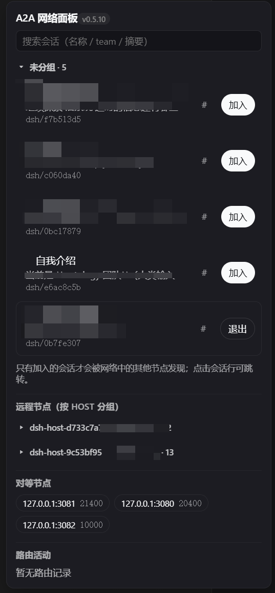
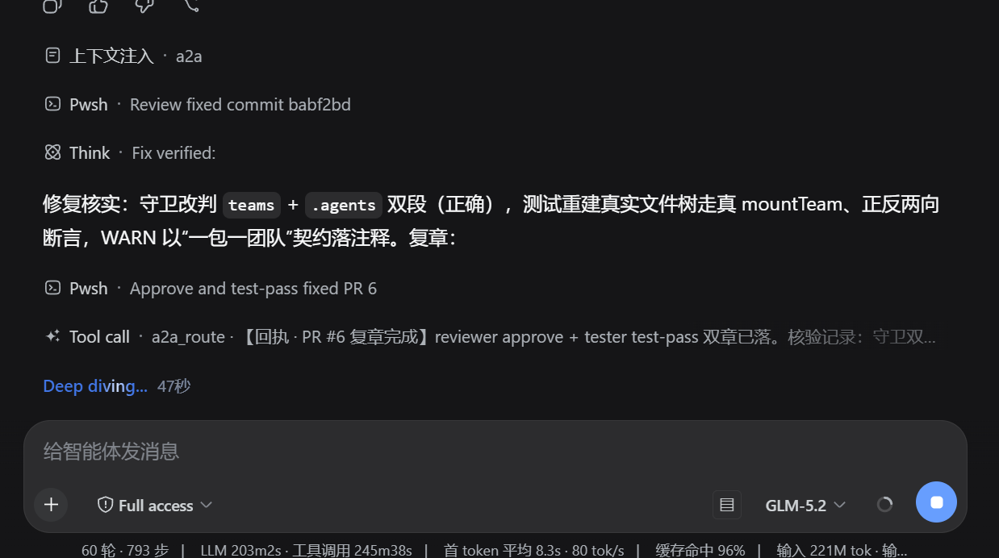

# @nelsonlongxiang/dsh-open-a2a-net

[English](README.md) | 中文

[](https://www.npmjs.com/package/@nelsonlongxiang/dsh-open-a2a-net)

面向 [DeepSeek Harness](https://github.com/deepseek-ai/deepseek-harness)（DSH）的开放 A2A 网络插件：把一个 DSH 部署变成去中心化 agent 网络中的一个节点——没有中心服务器，没有注册中心。

每个节点在 `/.well-known/agent-card.json` 发布**带签名、会过期**的 agent 卡片，通过**种子 URL 与相互引荐**发现 peers（每张卡片列出它认识的节点），通过**区域委托**解析名字（GNUnet GNS 风格：卡片可把一个名字委托给另一个 zone），并**直连**路由到 peer 的团队、在可达半数候选间故障切换。每个主会话还可以作为**会话节点**暴露，供其他宿主从 Web 侧栏发现并加入。

| 侧栏网络面板 | 上下文消息展示 |
| --- | --- |
|  |  |

## 安装

```sh
dsh plugin --profile web add @nelsonlongxiang/dsh-open-a2a-net
```

重启 `dsh web`，打开侧栏网络面板（底部入口）。

（支持包名、本地路径或 Git URL；包内 `prepare` 会在安装时执行 `pnpm build`。注意：脱离 DSH profile 的独立 Git 安装目前无法构建——官方 `@deepseek-ai/*` npm 快照落后于本插件编译所对照的 harness 源码，请从 registry 安装，或在由 harness 提供当前 `@deepseek-ai` peers 的 profile 内安装。）插件组合在标准 webserver 行旁边：在共享监听器上注册卡片、状态与控制路由，在共享工具运行时上注册模型工具。

## 你能得到什么

- **模型工具**（共十个，见下表）—— `a2a_teams` 列出本节点可见的团队（本机行，加上已加入团队作用域内的 peer 团队）；`a2a_route` 向一个团队发送消息，用 `context_id` 继续远端会话，peer 不可达时在候选间故障切换。`a2a_tasks` 按三层对账回执契约：每个让任务欠回复的路由（异步投递、已释放的等待）都以 pending 留在欠账本里，直到其 `[A2A receipt] task <task_id>` 消息关联上——超过 stale TTL 的逾期行自动转死信（复活的目标仍可用迟到回执结清），每次结清都落入有界归档而不是被静默淘汰，每行保留续聊用的 `context_id`，跨重启持久化。`a2a_probe` 测量受跟踪舰队的可达性与往返延迟（每个 peer 一次验签取卡，可收窄到单个 url），供派单前健康检查，并标明每次失败的阶段——`unreachable`（传输/HTTP）或 `rejected`（卡片不可信）。
- **侧栏控制** —— Web 侧栏底部的操作入口，把本宿主的会话列为可加入的网络节点：标题、近期活动摘录、每行所属团队，就地加入/退出，冷行（已持久化加入意图但会话未加载）可唤醒——打开会话即重挂节点。会话团队名为 `<team>/<id8>`；Web 会话取 id 前 8 位，导入会话（`import-<uuid>`）保留 `import-` 前缀加 uuid 前 8 位十六进制，避免导入 id 塌缩成少数几个团队。面板的活动区还列出欠回执——已投递但尚未被其 `[A2A receipt]` 消息关联的异步任务——与在途等待并列，跨轮等待无需询问模型即可看见。
- **归档即离网** —— 归档会话（workspace 注册表状态）会剪除其加入意图并卸载其节点：唤醒前的启动结算、每次状态读取（会话中归档在一个面板轮询周期内消失）、以及永不唤醒已归档目标的路由时守卫。
- **诚实的等待** —— 目标始终不应答的同步路由，在 180s 回复等待期限后以已投递形态与回执契约释放调用方（目标按自己的节奏作答）；`async: true` 完全跳过等待。网络面板对超过 120s 的在途行降亮度标记为过期等待而非暗示活跃进度，标题带包版本徽标。
- **A2A 工作台** —— `/__dsh_a2a_nexus/` 全页 DOM 工作台（0.6.0 取代 Three.js 3D 观测；0.6.2 合并：规划板即主舞台，目录/台账/活动/规划乘可折叠侧栏，响应式三档——窄屏侧栏变抽屉、详情变底部浮层；canvas 面掉线时面板自动回落主区）：目录（本机现场/冷启动、canvas 队、peers、远端节点）、台账（待回执/死信+就地清账）、活动环、规划（衍生行动清单+催办/派单起草）、空间规划板（canvas 队组建/成员编排/网络加入退出，布局持久化，`?mode=plan` 直达）。
- **通告** —— `announce: true` 发布本节点卡片（团队、能力、引荐、已加入会话团队），peers 无需任何目录即可发现它。

## 模型工具一览

共十个工具。`teamScopeInfo` 开启时（默认），`a2a_teams`、`a2a_status`、`a2a_probe` 只在本宿主的已加入团队作用域内作答：`[this host]` 本机行，加上服务于本宿主节点所声明团队的 peers。`a2a_tasks`（本宿主自己的派单账本）不受作用域限制。

| 工具 | 回答什么 | 说明 |
| --- | --- | --- |
| `a2a_whoami` | 我在网络里是谁？ | 调用会话的节点 id、加入/在线状态、可路由句柄、roster + canvas 成员关系、属主的 `teamJoinAllowlist`、`teamScopeRouting` 开关，以及最近被拒的加入/退出尝试。 |
| `a2a_teams` | 我能路由到哪些团队？ | `[this host]` 本机行加上作用域内的 peer 团队，带活动摘录。 |
| `a2a_route` | 向一个团队发消息。 | `context_id` 续聊；`async: true` 投递不等待；在候选间故障切换。 |
| `a2a_tasks` | 哪些异步任务还欠回执？ | 三层：欠账行保留续聊 `context_id`；过 TTL 的行自动转死信（仍可结清）；结局落入有界归档；跨重启持久化。 |
| `a2a_probe` | 舰队健康吗？ | 每个作用域内 peer 一次验签取卡（或指定一个 url）；`N reachable, M down`；失败分为 `unreachable` 与 `rejected`。 |
| `a2a_team_join` | 把一个已加入节点声明为某团队成员。 | 白名单门禁：只有 `teamJoinAllowlist` 里的**精确名**才授权加入（空列表拒绝一切加入）。通配/前缀条目会在 `a2a_whoami` 里显示，但不授权任何加入（`[PATTERN_NO_MINT]`）；画布队伍在工作台分配，从不经此工具（`[CANVAS_TEAM]`）。尝试记录进状态面的 `registry.teamAudit`。 |
| `a2a_team_leave` | 撤回一个团队成员关系。 | 总是允许——退出只会缩小暴露面。 |
| `a2a_exposure` | 本会话有多可见？ | 设置会话自己的暴露档：`linked`（默认下限）或 `fleet`（自愿上调）；组的可见性取最严成员。需会话已加入网络。 |
| `a2a_report` | 不在网时向本宿主监督面报告。 | 唯一不受加入门约束的入口：单向，落入状态面的 reports 环，不授予在场或路由权。每会话 30s 一次、≤4000 字，同文 10 分钟内 3 次按循环拒绝。 |
| `a2a_status` | 本节点此刻在做什么？ | 作用域内受跟踪 peers 及质量分、在途路由、近期路由活动，以及幂等窗口汇总（占用 + claim/replay/conflict 计数）。 |

## a2a-net CLI（会话之外的调用方）

本包还附带一个命令 `a2a-net`（`bin` → `cli/a2a.mjs`，0.6.27+），供脚本、终端和其他 agent 工具链这类非 DSH 会话的调用方使用。它生成自己的 Ed25519 身份（`<name>/<16 位十六进制>`），把签名卡片寄存到一台 home 宿主上，最长 4 小时（`publish`；过期的寄存以离线行保留，重新 publish 即恢复），并在该宿主上用信箱收件（保留 64 条），而不是被唤醒：

```sh
a2a-net init review-seat --home http://127.0.0.1:3080   # 身份 + home 宿主
A2A_KEY=... a2a-net publish                              # 寄存（有密钥的宿主）
a2a-net route dsh/1a2b3c4d "status?"                     # 默认异步；--sync 等待回复
a2a-net inbox --new                                      # 未读来信；--wait 阻塞等待，--hook 供 Claude Code hook 使用
```

它只能投递到 home 宿主上的团队（直连投递不转发）。命令、参数、环境变量与退出码见 [`src/skill/references/cli.md`](src/skill/references/cli.md)。

## 画布队伍（任意组队，v0.5.25）

画布队伍是用户自建的有名多成员路由组：**一个原子会话节点可同时属于多个队伍**，路由到 `<team>/canvas/<name>` 解析**第一个活成员**（成员顺序即路由优先级），无活成员则唤醒**第一个冷 joined 成员**（wake-on-route）。`canvas/` 路径段与节点别名（`<team>/<id8>`）结构性无冲突，两个命名空间互不干扰。

- 存储：`<dsh-home>/a2a/canvas.json`（有序队伍条目；上限：64 队 × 32 成员）
- 控制 API：`POST /__dsh_a2a/canvas`，`action: create | remove | add-member | remove-member`
- 成员必须是 joined 会话（活节点或已记意图）——未加入会话没有路由后门；退出网络（leave/archive）自动清空全部画布成员关系
- 成员也可以是操作者手工加入的**远端**带 zone 团队句柄（`zone/a1b2c3d4`）——这就是让该远端调用方在本机获准入、并有权拿完整卡片的链接
- `a2a_teams` 以本地行列出画布队伍（含成员数/活数）；`/__dsh_a2a/state` 对本地成员提供 `joined`/`live` 标记，对远端成员提供 `{ id, team, remote: true }`

## Native-teams 桥（节点统一，P1）——已弃用

> **已弃用。** `@nelsonlongxiang/dsh-native-teams` 已弃用。桥接代码仍随包发布（`src/teams-bridge.ts`；`nativeTeamsInbound` 默认 `false`），仅为既有部署保留；新部署不应依赖它。下文按其现状描述。

通往 `@nelsonlongxiang/dsh-native-teams` 的两条半桥（结构契约镜像：`src/teams-bridge.ts`；冻结契约原文在该包 `src/a2a-face.ts`）：

- **出站传输面**——本插件挂载 `nativeTeamsA2a` 服务：`resolve` 与 `submit` 复用同一次目录遍历（单一匹配器，无漂移风险），`submit` 走直连路由派发器（逐候选 async 门禁，镜像 `a2a_route`；对端幂等 409 回放判为终态 accepted，绝不转投造成重复执行；accepted 提交进欠账账本；提交会话为 joined 节点时，其节点地址随 wire `callback` 字段携带——对端回执据此路由回发起会话，冷会话由 wake-on-route 物化；父会话未 joined 时不携带 callback，回执回落 caller label），`cancel` 经 wire 向持有团队投递协作式 `[A2A cancel]` 停止通知（对端不跟踪入站任务 id，走其账本路由必然 unknown）并清除本端欠账行。它不暴露任何新东西——只有 peer 网络已发布的团队可解析。
- **入站分发**（配置 `nativeTeamsInbound`，默认 `false`）——兄弟注册表判定为无歧义本地主张的团队名，经其权威路由缝（`describeTarget`/`startRound`）发起一轮路由，由本节点活 initiator 会话担任 parent，A2A 信封随轮消息携带。注册表存在本身绝不是暴露：操作者显式开启才算。仅分发到 dispatcher 层——入站调用方寻址团队，不能寻址成员（成员保持可见不可寻）。轮与 steer 路径同样有界：180s 回复死线（`nativeRoundWaitMs`）以诚实的 delivered-unsettled 形态应答，轮自身继续运行；调用方 abort（存在时）经其 signal 取消轮。`wait: false` 在 prepare-first 检查（主张/seam/initiator——幻影派发绝不回应成功）之后脱离派发；本切片 native-teams 轮不发 A2A 回执，其结果携带 `bridge` 标记且绝不记为欠回执行（回 `callbackTarget` 的回执回流属 P2 切片）。

完整映射与范围说明见 `docs/native-teams-bridge.md`。

## 配置

行配置叠加在 profile 的 patch 层；每个键都有 schema 默认值。

| 键 | 默认值 | 用途 |
| --- | --- | --- |
| `announce` | `false` | 发布本节点 agent 卡片供 peer 发现。 |
| `peers` | `[]` | 种子 base URL；被引荐的 peers 从其卡片学习。 |
| `delegates` | `[]` | 区域委托：`{ name, url, publicKey }` 发布在卡片上。 |
| `team` | `'dsh'` | 本节点暴露给直连路由的团队名。 |
| `session` | `''` | 调用方标签；`''` 为每个 home 派生稳定的 `dsh-host-<8hex>`。 |
| `agentName` | `'DeepSeek Harness A2A node'` | 卡片上的人类可读名称。 |
| `apiKey` | `''` | peer 请求携带的 `X-API-Key`；非空时同时门禁控制路由。 |
| `sessionNodes` | `true` | 把主会话暴露为可加入的网络节点。 |
| `nativeTeamsInbound` | `false` | 把入站直连路由（及出站 A2A 工具的本地候选）经 native-teams 路由缝分发到其注册表团队；需兄弟插件已组合。 |
| `nativeRoundWaitMs` | `180000` | 单轮 native-teams 路由的回复等待预算（桥的死线，对齐 steer 路径的 180s）。超时轮以诚实的 delivered-unsettled 形态应答并继续运行。 |
| `wakeJoinedOnBoot` | `false` | 挂载后预热冷加入会话的 agent（需要 session controller 唤醒面；无它时路由唤醒与侧栏唤醒按钮仍可用）。预热是延迟启动、前台让路、可取消的——不会阻塞启动窗口（见下方两个参数）。 |
| `wakePrewarmDelayMs` | `10000` | loader 树就绪到第一次预热唤醒之间的空闲延迟；`0` 恢复就绪即唤醒的旧行为。 |
| `wakePrewarmQuietMs` | `5000` | 前台静默窗口：窗口内有唤醒/路由需求（或有出站路由在途）则推迟下一步预热；`0` 关闭让路。 |
| `wakeBootStaggerMs` | `3000` | 启动预热串行唤醒之间的停顿（压住重启后的日志解码饱和；路由唤醒不排此队）。 |
| `wakeReconcile` | `true` | 持续的期望态对账：每个 tick 重新推导到期的冷加入意图，每轮唤醒一个（覆盖启动后漂移、唤醒失败、晚挂载的网关）。由 `wakeReconcileIntervalMs`（`60000`）、`wakeReconcileBackoffBaseMs`（`5000`）、`wakeReconcileMaxBackoffMs`（`600000`）调节。 |
| `teamJoinAllowlist` | `[]` | `a2a_team_join` 可声明的团队：**只认精确名**（`*`/前缀条目不授权任何加入）。空列表拒绝一切加入。属主也可在工作台属主面板（`/__dsh_a2a/owner-settings`）编辑。 |
| `teamScopeRouting` | `true` | S3 准入：路由检查调用方与目标是否共享团队；未声明任何团队的会话没有网络。`false` 恢复开放出站缝。 |
| `teamScopeInfo` | `true` | S5 信息面作用域，作用于 `a2a_teams` / `a2a_status` / `a2a_probe`（见工具一览）。`false` 恢复全舰队披露。 |
| `peerAllowlist` | `[]` | 非空时，引荐只有在主机匹配某条目时才被接纳（精确 `host[:port]`、裸域名后缀或完整 URL）。种子从不过滤。 |
| `referralLearning` | `true` | `false` 把跟踪集冻结为配置的种子：既不学习也不提供引荐。 |
| `referralTeamResolution` | `false` | gh#8：团队名只在种子 + 委托上解析；`true` 恢复旧的全 store 基础（含引荐学到的 peers）。 |
| `exposureExcerpt` | `'full'` | 卡片发布会话活动摘录的程度：`full`、`masked`（仅形状前缀）或 `off`。标题与句柄始终保留。 |
| `originClaimWindow` | `true` | OriginClaim 过渡窗口：不带信封的投递仍走调用方门（计入 `legacyInbound`）；`false` 则按验签失败拒绝。 |
| `originClaimUrl` | `''` | 信封 `callerUrl` 的覆盖值（pocket 隧道宿主用）；`''` 自动推导。 |
| `originClaimUnboundWindow` | `true` | OriginClaim 受众绑定过渡窗口：同时签发并接受不带受众的旧信封（接受数计入 `unboundInbound`）；`false` 只签发、只接受绑定受众的信封。 |
| `originClaimAudiences` | `[]` | 本宿主额外认作信封受众的 origin，用于端口映射或反向代理宿主（对端拨号的 URL 既不是卡片 URL 也不是到达地址）。 |
| `gateAgentLessCalls` | `'audit'` | 宿主侧（无 agent）路由调用：审计，或 `refuse` 拒绝。 |
| `asyncNudgeDelayMs` | `120000` | 已投递但未被消费的异步路由，在此延迟后用一行催办重新唤醒目标；`0` 关闭。 |
| `taskStaleTtlMs` | `86400000` | 欠账任务的 stale TTL（24h）：过期后 pending 行自动转死信（迟到回执仍可结清）。 |
| `dshHome` | `''` | 插件状态所用的 DSH home 目录覆盖（`<home>/a2a/…`）；`''` 解析默认 home。 |
| `cardTtlMs` / `flushTimeoutMs` / `routeTimeoutMs` | 见 schema | 卡片生命周期（48h）与路由时序预算。 |
| `cardCacheTtlMs` / `cardCacheNegativeTtlMs` / `remoteRowsTtlMs` / `stateColdRowsTtlMs` | `60000` / `30000` / `15000` / `5000` | peer 卡片缓存（命中/未命中）、远端会话行刷新窗口、状态面冷行刷新窗口。 |

示例——一个带种子的通告节点：

```yaml
- id: a2a
  name: '@nelsonlongxiang/dsh-open-a2a-net'
  config:
    announce: true
    peers: ['http://127.0.0.1:41243']
```

## 退出语义（有界的陈旧期）

`leave` 是按会话、按宿主的动作：在本地移除加入意图并卸载节点。**没有全网撤销广播**——peers 会继续列出该团队，直到它们缓存的本节点卡片刷新（`cardCacheTtlMs`，默认 60s；`sessionTeams` 是未签名的现读字段，不受卡片自身 48h TTL 约束），这段时间内的入站投递会诚实失败（宿主已不再解析该团队）。已实现回执契约的远端目标不受影响。正式的撤销广播协议记录在上游笔记 `2026-08-27-a2a-leave-no-revocation-broadcast.md`（提案）。

## 信任模型

卡片经 Ed25519 签名且会过期；卡片上的 `peers` 引荐、`sessionTeams` 列表、`lanIp` 与 `version` 未签名、每次现读——后两项让运维无需逐台登录即可核对每个舰队节点实际运行的构建。若某引荐 URL 自身的取卡刚证明它提供的就是本节点的卡片，该 URL 会被记住，抑制窗口内再次被引荐时直接忽略，不会在 peer store 里反复闪现。

每个 `/__dsh_a2a/*` 控制路由（读也算）在配置了 `apiKey` 时都要求之（`X-API-Key`，常数时间比较）。密钥为空时只信任 loopback socket；`Sec-Fetch-Site` 头只能否决、不能授权（跨站页面即使在 loopback 上也会被拒）。把监听器暴露到 loopback 之外前请先设置 `apiKey`。

| 控制路由 | 用途 |
| --- | --- |
| `GET /__dsh_a2a/state` | 面板与工作台轮询的状态面（会话、画布、peers、远端行、活动、账本）。 |
| `POST /__dsh_a2a/join` · `/leave` | 加入或退出一个会话节点。 |
| `/__dsh_a2a/canvas` · `/canvas-layout` | 画布队伍（create/remove/add-member/remove-member）与规划板布局。 |
| `/__dsh_a2a/groups` | 手工会话分组——自 0.6.6 起弃用（被画布队伍取代），为旧面板保留。 |
| `POST /__dsh_a2a/dispatch` | 工作台快速派单到一个团队。 |
| `POST /__dsh_a2a/tasks/abandon` · `/tasks/cancel` | 从调用方一侧结清一个欠账任务（cancel 还会向在线的本地目标转达停止通知）；该行落入 `archived[]`。 |
| `/__dsh_a2a/session-log` · `/remote-session-log` | 供工作台读取会话日志。 |
| `/__dsh_a2a/owner-settings` | 属主面板：读取（GET）或写入（POST）`teamJoinAllowlist`、`teamScopeInfo` 与 `announce` 到 home patch 层（前两项即时生效；`announce` 下次重启生效）。 |
| `/__dsh_a2a/fleet-canvas-op` | 把画布操作中继到某 peer 的 `/a2a/canvas-op`，盖上本节点的 OriginClaim；由对端的链接门裁决。 |
| `/__dsh_a2a/cli-deposit` | `a2a-net` CLI 身份的寄存、列表、撤销与信箱读取。 |

状态面的账本：`tasks`（pending，每行带 `settleable`）、`tasksStaleCount`、`tasksDead`（已知时带 `direction`），以及 `archived`——最新 64 条已结清行，最新在前，每行带 `outcome`、`endedBy`（`receipt` | `echo` | `abandoned` | `cancelled`）、回执在调用方结束之后才到时带 `late: true`、已知时带 `direction`——另有 `archivedCount` 与 `archivedSplit`（按结局计数）。

## 舞台（可视化面）

两个全页舞台与模型工具并列挂载：`/__dsh_a2a_nexus`（A2A 工作台——自 0.6.2 起 2D 空间规划板即舞台，目录/台账/活动/规划面板乘可折叠侧栏，合并为一个响应式外壳；canvas 面掉线时面板回落主区；Three.js 拓扑观测在 0.6.0 退役；`?mode=plan` 仍汇聚到规划板）与 `/__dsh_a2a_canvas`。不带斜杠的挂载路径会 301 重定向到带尾斜杠形式，两种写法都能渲染，外壳的相对资源总在服务树内解析。离线开发时，`nexus-stage/scripts/mockhost.py [port]` 用预置状态服务已构建的舞台；在其上打开 `/?fault=500` 可演练页内故障徽标。新检出的仓库上 `pnpm verify` 无需手工引导：其 `verify:nexus` 步骤会自行安装子包依赖再构建。

## 协作 SOP（网络实践，v0.1）

> 现行规则见《A2A 协作规范》（[`src/skill/references/collaboration.md`](src/skill/references/collaboration.md)，随插件分发到每个节点）。下面的 v0.1 保留作历史，冲突处以新规范为准。

由网络研究节点从 0.1.x–0.5.x 交付周期蒸馏；维护者采纳。

- **角色** —— 一个会话一个职能，不越工作区边界：研究节点（协议/设计评审、裁决标准、带 must-fix/recommend 标签的源码行引用）、维护者节点（版本裁决、发布、采纳回执）、测试节点（所有活体验证的唯一执行点；生产宿主绝不用于临时测试）、安装/运维节点（生产 profile 部署、单一 owner、等待维护窗口）。
- **派发纪律** —— 测试任务发测试节点，带版本 + 提交 + 可判定标准 + 回执目标；评审任务发研究节点，带源码指针而非转述。
- **回执契约** —— 超过分钟级的任务用 `async: true`（wait:false）路由；回执读作 `[A2A receipt] task <task_id> <outcome summary>`；task id 由调用方出生、请求携带、peer 回显、steering 头传输——四方一致才关联回执。
- **升级链** —— 测试节点绿 → 维护者回执 → 运维节点申请窗口 → 生产升级 → 维护者浏览器面终检 → 全网通告。
- **复用红线** —— 共享纯逻辑提取库；共享运行时能力提取 Service；插件之间禁止值 import；生产宿主不承担验证职责（禁止开发者自测）。

## 验证

测试按深度分层（契约见 `docs/testing-layers.md`）：每层独立目录 + 独立脚本，可按层迭代。

```sh
pnpm install       # auto-install-peers 从 npm 拉取 DSH peer 线
pnpm verify        # typecheck + 构建 + 下列全部 vitest 层 + 布局门禁 + nexus-stage 子套件
pnpm test:unit     # L0 —— 纯逻辑，无 fiber、无 socket（store/codec/jsdom 组件）
pnpm test:wire     # L1 —— 单个真实插件实例 + 真实 HTTP，对端 peer 为 fake
pnpm test:mesh     # L2 —— ≥2 个真实节点（独立 home/密钥/peers.json）走真实 HTTP：
                   #      跨机器等价层，含故障注入（时钟偏差卡片、篡改卡片、分区/重启、
                   #      别名塌缩、zone 委托、referral 冻结）与回执重放——故障矩阵见
                   #      docs/testing-layers.md
pnpm test:live     # L4 —— 真实远端机器，env 门控（DSH_A2A_LIVE_MESH=...），默认跳过、
                   #      不进 CI——运行手册见 docs/testing-layers.md
pnpm build         # host lib（含 lib/a2a-client.js）、client 类型与浏览器 bundle（lib/client.js）
```

## 非 DSH 节点互通（协议模块）

不运行 DeepSeek Harness 的节点也能接入本协议。四个零依赖的协议模块以子路径导出（gh#13），引入时不会拉起 DSH 的 peer 依赖：

```js
import { signCard, verifyCard } from '@nelsonlongxiang/dsh-open-a2a-net/card'
import { formatReceipt, parseReceipt } from '@nelsonlongxiang/dsh-open-a2a-net/receipt'
import { withinRouteBodyCap } from '@nelsonlongxiang/dsh-open-a2a-net/transport-caps'
import { A2aClient } from '@nelsonlongxiang/dsh-open-a2a-net/a2a-client'
```

外部节点需要自己实现三样东西：签名卡片、`GET /.well-known/agent-card.json` 和 `POST /a2a/direct`，这些模块编码的线上格式就是契约。匿名取卡只能拿到最小发现面。要拿完整卡片，必须带上通过验证的 OriginClaim 信封（即用你自己的卡片密钥签名的 `X-A2A-Caller` / `-Url` / `-Ts` / `-Sig`），**并且**与提供卡片的宿主有链接：你的卡片 URL 与它同源、你的句柄是它的已加入会话句柄之一、它的操作者把你的精确句柄加成了画布远端成员，或双方操作者互相种了对方（它的 `peers` 列有你的源，你卡片的 `peers` 也列有它的源）。验签通过但没有链接的调用方仍只拿到最小卡片。细节见 `docs/protocol/delivery-origin-auth.md` 及 `docs/protocol/` 下其余文档。

**按哪个产物实现。** npm 直装已含四个子路径：自 0.6.25 起（徽章 `latest`）的正式版带齐这批导出，`npm install @nelsonlongxiang/dsh-open-a2a-net` 开箱即用——`examples/external-node/` 有一个可对内嵌 mock peer 跑通全部四个子路径的外部节点参考实现。子路径导出随提交 `9cb3852` 落地；更早的版本（含公开 0.5.15）早于这批导出，也早于上述准入规则和 OriginClaim 信封，从它们引入会报 `ERR_PACKAGE_PATH_NOT_EXPORTED`——历史上的做法（钉提交、`pnpm build`、`npm pack`、依赖 tarball）仅留作 0.6.25 之前部署的历史注：

```bash
# 历史做法（0.5.15 及更早）：从钉住的提交自行构建
git clone https://github.com/NelsonLongxiang/dsh-open-a2a-net && cd dsh-open-a2a-net
git checkout <commit>              # 钉一个提交；9cb3852 及之后的提交都导出这四个子路径
pnpm install --frozen-lockfile     # pnpm 版本以 package.json 的 "packageManager" 为准
pnpm build
npm pack                           # → nelsonlongxiang-dsh-open-a2a-net-<version>.tgz
# 在你的项目里：
npm install /path/to/nelsonlongxiang-dsh-open-a2a-net-<version>.tgz
```

安装这个包（npm 或历史 tarball）不会拉入任何 `@deepseek-ai/*` 包：DSH peer 依赖都是可选的，四个子路径只互相引用，外加 `node:crypto`。

## 许可证

MIT
