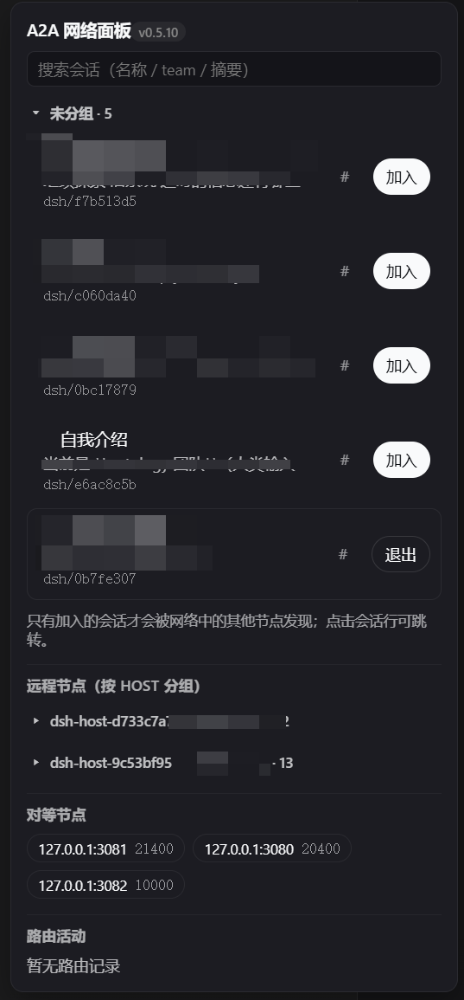
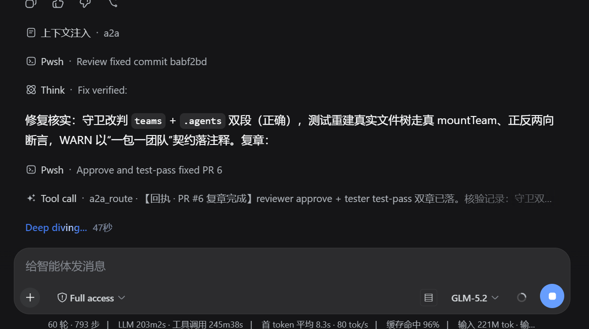

# @nelsonlongxiang/dsh-open-a2a-net

[English](README.md) | 中文

[](https://www.npmjs.com/package/@nelsonlongxiang/dsh-open-a2a-net)

面向 [DeepSeek Harness](https://github.com/deepseek-ai/deepseek-harness)（DSH）的开放 A2A 网络插件：把一个 DSH 部署变成去中心化 agent 网络中的一个节点——没有中心服务器，没有注册中心。

每个节点在 `/.well-known/agent-card.json` 发布**带签名、会过期**的 agent 卡片，通过**种子 URL 与相互引荐**发现 peers（每张卡片列出它认识的节点），通过**区域委托**解析名字（GNUnet GNS 风格：卡片可把一个名字委托给另一个 zone），并**直连**路由到 peer 的团队、在可达半数候选间故障切换。每个主会话还可以作为**会话节点**暴露，供其他宿主从 Web 侧栏发现并加入。

| 侧栏网络面板 | 上下文消息展示 |
| --- | --- |
|  |  |

## 安装

```sh
dsh plugin --profile web add @nelsonlongxiang/dsh-open-a2a-net
```

重启 `dsh web`，打开侧栏网络面板（底部入口）。

（支持包名、本地路径或 Git URL，参数原样交给 pnpm。包的 `prepare` 脚本是 `pnpm build`，但只有 Git URL 安装会在安装时触发它，而且 pnpm 11 会拦住 Git 包的构建脚本：`dsh plugin` 会报错并打印确切的键，须把它加到 profile 的 `pnpm-workspace.yaml` 的 `allowBuilds` 下再重跑。registry 安装的包已带构建产物，不再构建；本地路径安装不会构建，须先在该目录执行 `pnpm build`。构建需要 pnpm ≥11.24 且 <12（见 `package.json` 的 `engines`）。脱离 DSH profile 的独立 Git 安装现在可以构建（`@deepseek-ai/*` peers 取自 npm；0.7.0 实测通过），不再需要限定 registry 或 profile 安装。）插件组合在标准 webserver 行旁边：在共享监听器上注册状态与控制路由（`/__dsh_a2a/*`，`sessionNodes` 开启时，默认开启），在共享工具运行时上注册模型工具；卡片路由 `/.well-known/agent-card.json` 只在 `announce: true` 时注册（默认关闭）。

## 你能得到什么

- **模型工具**（共十二个，见下表）—— `a2a_teams` 列出本节点可见的团队（本机行，加上已加入团队作用域内的 peer 团队）；`a2a_route` 向一个团队发送消息，用 `context_id` 继续远端会话，peer 不可达时在候选间故障切换。`a2a_tasks` 按三层对账回执契约：每个让任务欠回复的路由（异步投递、到 180s 期限被释放的同步等待；调用方自行中止的同步等待不入账，没有可路由回调地址的投递只登记为「无回执债」的可见行）都以 pending 留在欠账本里，直到其 `[A2A receipt] task <task_id>` 消息关联上——超过 stale TTL 的逾期行自动转死信（复活的目标仍可用迟到回执结清），每次结清都落入有界归档而不是被静默淘汰，每行保留续聊用的 `context_id`，跨重启持久化。`a2a_probe` 测量受跟踪舰队的可达性与往返延迟（每个 peer 一次验签取卡，可收窄到单个 url），供派单前健康检查，并标明每次失败的阶段——`unreachable`（传输/HTTP）或 `rejected`（卡片不可信）。
- **侧栏面板** —— Web 侧栏底部的网络入口，已瘦身为本宿主的最近网络动态（`docs/design/panel-activity-feed.md`）：在途路由、欠回执（只列可结算的欠账，对话式已送达的陈旧尾巴只计数）与路由活动环并列，跨轮等待无需询问模型即可看见；同机会话的活动行点击可在 GUI 内跳转到该会话；入站未读徽标，标题带包版本徽标，并提供工作台入口。会话的入网/退网、画布队与成员编排不再在侧栏里做，已迁入下面的工作台规划板。会话团队名为 `<team>/<id8>`；Web 会话取 id 前 8 位（先去掉 `session-` 前缀），导入会话（`import-<uuid>`）保留 `import-` 前缀加 uuid 前 8 位十六进制，避免导入 id 塌缩成少数几个团队。
- **归档即离网** —— 归档会话（workspace 注册表状态）会离开节点网络：卸载其节点、撤回其 roster 声明、从列表与卡片中隐藏，并永不被唤醒——发生在唤醒前的启动结算、每次状态读取（会话中归档在一个状态轮询周期内消失）、以及路由时守卫三处。**加入意图保留**在 `joined.json`（曾因瞬时读到归档态而抹掉入网姿态，导致冷会话再也唤不醒），剪除事件记入状态面 `registry.teamAudit` 的 `archive-prune`。
- **诚实的等待** —— 目标始终不应答的同步路由：本机会话目标在 180s 回复等待期限后以已投递形态（`TASK_STATE_DELIVERED`）与回执契约释放调用方（目标按自己的节奏作答）；经直连的远端 peer 受 15s 传输预算约束，超时先经任务查询补偿（对端已完成则升级为真实结果），否则以 `-32005`「已投递未结清」失败返回，须按任务查询对账、不要盲目重发。`async: true` 完全跳过等待。网络面板对超过 120s 的在途行降亮度标记为过期等待而非暗示活跃进度。
- **A2A 工作台** —— `/__dsh_a2a_nexus/` 全页 DOM 工作台（0.6.0 取代 Three.js 3D 观测；0.6.2 合并：规划板即主舞台，目录/主机/台账/活动/规划乘可折叠侧栏，宿主运行 superagent 团队时多一个「团队」页；响应式——宽屏 ≥1440px 加宽侧栏，≤1023px 侧栏变抽屉、详情变底部浮层，≤680px 页头折行；canvas 面掉线时面板自动回落主区）：目录（本机会话现场/冷启动、画布队、远端节点、本机日志）、主机（tracked peers 的健康与 linked 徽章）、台账（待回执/死信+就地清账）、活动环、规划（衍生行动清单+催办/派单起草，均生成可复制文本）、空间规划板（canvas 队组建/成员编排/网络加入退出，布局持久化；`?mode=plan` 仅为旧链接兼容，canvas 面在线时本就默认进入规划板）。
- **通告** —— `announce: true`（默认 `false`，需要组合了 web server）发布本节点签名卡片，peers 无需任何目录即可发现它。引荐 `peers` 只给经签名验证、且已配种子或已链接的调用方；已加入会话团队 `sessionTeams`、roster 与画布组织只给已链接的调用方；其余调用方只得到最小发现卡（名称、团队、能力、记录与签名）。未入网的会话节点不在卡片里公布。

## 模型工具一览

`teamScopeInfo` 开启时（默认），`a2a_teams`、`a2a_status`、`a2a_probe` 只在本宿主的已加入团队作用域内作答：`[this host]` 本机行，加上服务于本宿主节点所声明团队的 peers。`a2a_tasks`（本宿主自己的派单账本）不受作用域限制。

| 工具 | 回答什么 | 说明 |
| --- | --- | --- |
| `a2a_whoami` | 我在网络里是谁？ | 调用会话的节点 id、加入/在线状态、可路由句柄、roster + canvas 成员关系、属主的 `teamJoinAllowlist`、`teamScopeRouting` 开关，以及最近被拒的加入/退出尝试。 |
| `a2a_teams` | 我能路由到哪些团队？ | `[this host]` 本机行加上作用域内的 peer 团队，带活动摘录。 |
| `a2a_route` | 向一个团队发消息。 | `context_id` 续聊；`async: true` 投递不等待；在候选间故障切换。 |
| `a2a_task_read` | 那条任务的正文到底写了什么？ | 按任务号返回投递给**本会话**的 A2A 任务原文。适用于 `a2a_tasks` 里只看得到标题（`delivered-unconsumed`）、送达时本会话正忙、正文没进对话的任务。只有当初接收的会话能读，别的会话一律按“不存在”答复；原文保留 72 小时，单条 64 KiB，超出部分截断。读取即算已消费，结果算对端内容。会话空闲时，空闲对账也会以原发送方的名义把这类原文补送一次。 |
| `a2a_tasks` | 哪些异步任务还欠回执？ | 三层：欠账行保留续聊 `context_id`；过 TTL 的行自动转死信（仍可结清）；结局落入有界归档；跨重启持久化。 |
| `a2a_probe` | 舰队健康吗？ | 每个作用域内 peer 一次验签取卡（或指定一个 url）；`N reachable, M down`；失败分为 `unreachable` 与 `rejected`。 |
| `a2a_team_join` | 把一个已加入节点声明为某团队成员。 | 白名单门禁：只有 `teamJoinAllowlist` 里的**精确名**才授权加入（空列表拒绝一切加入）。通配/前缀条目会在 `a2a_whoami` 里显示，但不授权任何加入（`[PATTERN_NO_MINT]`）；画布队伍在工作台分配，从不经此工具（`[CANVAS_TEAM]`）。尝试记录进状态面的 `registry.teamAudit`。模型工具只能为调用会话自己的节点声明（否则 `[NOT_SELF]`），且该节点须已入网（否则 `[NOT_JOINED]`）。 |
| `a2a_team_leave` | 撤回一个团队成员关系。 | 不受白名单门禁——退出只会缩小暴露面；仍只能撤回调用会话自己节点已声明过的成员关系（`[NOT_SELF]`、`[NOT_JOINED]`，未声明过则无事可退）。 |
| `a2a_exposure` | 本会话有多可见？ | 设置会话自己的暴露档：`linked`（默认下限）或 `fleet`（自愿上调），可随时升降；需会话已加入网络。**目前档位只持久化（`a2a/exposure.json`）并在状态面会话行的 `exposure` 字段展示，尚不改变卡片或目录的可见性**；「组的可见性取最严成员」是已成文的规则，v1 既无组级接口也无执行点。 |
| `a2a_report` | 不在网时向本宿主监督面报告。 | 唯一能在未入网时向本宿主写入的入口（只读的 `a2a_whoami` 同样不受加入门约束）：单向，落入状态面的 reports 环（保留最近 64 条），不授予在场或路由权。每会话 30s 一次、≤4000 字；同会话同文在 10 分钟内已上报 3 次后，第 4 次起按循环熔断拒绝。 |
| `a2a_status` | 本节点此刻在做什么？ | 作用域内受跟踪 peers 及质量分、在途路由、近期路由活动，以及幂等窗口汇总（占用 + claim/replay/conflict 计数）。 |
| `a2a_file_send` | 把文件交给一个团队，又不把文件塞进消息。 | 每个文件（每次 ≤16 个，单个 ≤64 MiB）暂存在本宿主、授权给该团队 24 小时，然后只路由**一条**带 `[A2A file]` 引用行的消息；字节从不随消息走（#91）。需本宿主已发布卡片地址（`announce`），否则拒绝发送。 |
| `a2a_file_fetch` | 拉取别人引用的文件。 | 带本会话身份（`caller_session`）并盖上本宿主节点的 OriginClaim 信封，从暂存它的宿主拉取一条 `[A2A file]` 引用（引用指向本宿主时直接读本机暂存）；先核对大小和 sha256，再存到 `<cwd>/a2a-inbox/`。授权只对一个会话（或整台宿主、或某画布队的成员）；拉取总会把本会话标为读过对端内容。 |

## a2a-net CLI（会话之外的调用方）

本包还附带一个命令 `a2a-net`（`bin` → `cli/a2a.mjs`，0.6.27+），供脚本、终端和其他 agent 工具链这类非 DSH 会话的调用方使用。它生成自己的 Ed25519 身份（`<name>/<16 位十六进制>`），把签名卡片寄存到一台 home 宿主上，最长 4 小时（`publish`；过期的寄存以离线行保留，重新 publish 即恢复），并在该宿主上用信箱收件（保留 64 条），而不是被唤醒：

```sh
a2a-net init review-seat --home http://127.0.0.1:3080   # 身份 + home 宿主
A2A_KEY=... a2a-net publish                              # 寄存（有密钥的宿主）
a2a-net route dsh/1a2b3c4d "status?"                     # 默认异步；--sync 等待回复
a2a-net inbox --new                                      # 未读来信；--wait 阻塞等待，--hook 供 Claude Code hook 使用
```

从 0.6.38 起 `forwardDirect` 默认 `true`；本机目标未找到时，home 可替已验签且在线的 CLI 向已链接的对端目标转发一跳。两边运营者必须各自链接：A 链接 B 的接收成员，B 链接 CLI 句柄并将 home 钉为 A。画布目标只需 A 链接画布属主主机（#282 S3，同队即授权；属主主机须为 0.6.37 及以上）：接收成员在转发行出生时从属主签名名片冻结，回执只有来自这些成员、且由该属主公钥签名时才放行进 CLI 信箱并结算。作用域及结算 enforce 开启时，B 成员宿主的自动回执结清 A 的转发行并进入 CLI 信箱；`--sync` 返回 B 的回复，但转发路径上同步等待只有约 15 秒的传输窗口，超时返回 `-32005`（已投递未结清）：对端做完后仍会自动回执，请按 task id / `inbox` 对账，不要盲目重发；长任务用默认的异步 `route`，再 `inbox --wait --renew`。命令、参数、环境变量与退出码见 [`src/skill/references/cli.md`](src/skill/references/cli.md)。


### Pi 席位（让 Pi 作为 superagent 团队成员）

Pi coding agent 可以作为 superagent 团队的成员干活。席位就是一个寄存在团队宿主上的 `a2a-net` 身份，它自己签名的名片里声明了
`piSeat`（[docs/design/superagent-pi-platform.md](docs/design/superagent-pi-platform.md)）：

```sh
a2a-net init fleet-pi --home <团队宿主地址>   # 席位身份，home 必须是团队宿主
a2a-net publish --pi-seat                     # 带 capabilities.piSeat 寄存；续期会保留它（publish --renew）
a2a-net pi install                            # 把 a2a-seat 扩展复制到 ~/.pi/agent/extensions/（--dir、--force）
```

安装不等于入队：要由团队主人在团队画布上把这个 handle 加进来，加入时固定席位的密钥。续期（`publish --renew`、`inbox --wait --renew`）沿用上次显式 publish 的声明，`piSeat` 不会丢；不带 `--pi-seat` 的显式 `publish` 才会撤销它。扩展每小时续期一次，游标按席位分开保存（同一席位同时只由一个 Pi 进程消费），"本轮结束"在宿主收下之前会一直保留重发。扩展会轮询席位邮箱，把派来的活交给 Pi 会话，
并回报"已读"和"本轮结束"；模型用 `a2a-net ticket report|ack|handback|idle|read|error` 回报（对团队宿主的签名且绑定内容的请求）。
席位不能改团队规则、不能代主人说话；home 在其他主机上的席位本版不支持。提问就是一张决策卡：
`ticket report --question Q --options A|B --recommended A`。席位的"本轮结束"不带文字，有变化要用 `ticket report` 主动回报。

### 独立网络节点（不依赖 DSH 实例）

部署手册（安装、常驻服务、与 DSH 宿主互联、公网安全）：[docs/guides/standalone-node.md](docs/guides/standalone-node.md)。

`a2a-net serve --config node.json` 在一个独立的 Node 进程里运行网络层：名片与签名、对端目录、CLI 户口与信箱、一跳转发、canvas 归属、台账、状态面和工作台。它不承载 AI 会话，CLI 发往会话的消息按上述一跳转发规则交给已链接的 DSH 主机。「不依赖 DSH 实例」指不需要运行中的 DSH 主机；运行时仍需 `@deepseek-ai/*` 的 npm 包（缺失时 `serve` 会打印要安装的固定版本集合）。把它部署在一台稳定的机器上作为 CLI 的 home，DSH 重启就不会让 CLI 户口、信箱和 canvas 目录掉线（节点自身重启后也保留）。安装与配置见 [`src/skill/references/cli.md`](src/skill/references/cli.md) 的 `a2a-net serve` 一节。

## 画布队伍（任意组队，v0.5.25）

主机/成员的 linked 徽章按主机事实显示：双向 URL 种子，或该主机卡唯一列出的精确非本机画布成员句柄。同名 zone（例如全为 `dsh`）不再推断已链接；最小卡缺少会话列表时，除非双向种子能证明该主机，否则保守显示 stranger。该显示规则不改变调用方准入或 CLI home 校验。

画布队伍是用户自建的有名多成员路由组：**一个原子会话节点可同时属于多个队伍**，路由到 `<team>/canvas/<name>` 解析**第一个活成员**（成员顺序即路由优先级），无活成员则唤醒**第一个冷 joined 成员**（wake-on-route）；本机成员都不可用时，再依次落到远端成员（经目录解析其句柄，远端节点不会在这里被唤醒）。发起路由的会话自己不会占用本机两档（自路由规则，#41）。`canvas/` 路径段与节点别名（`<team>/<id8>`）结构性无冲突，两个命名空间互不干扰。

- 存储：`<dsh-home>/a2a/canvas.json`（有序队伍条目；上限：64 队 × 32 成员；文件另带版本号、成员属主锚、暂停记录与 CLI home 钉）
- 控制 API：`POST /__dsh_a2a/canvas`，`action: create | remove | add-member | remove-member`；`add-member` 对不存在的队伍会先建队。另有属主的成员来源与暂停治理操作 `confirm-member`、`restore-suspended`、`delete-suspended`（#334/#335），以及仅查询已有 CLI 成员候选的 `cli-home-options`。队名 ≤40 字，不含 `/`，不是纯数字，不以 `@<8 位小写十六进制>` 结尾，且不能被 roster 保留（`roster:` 前缀，或等于白名单/roster 团队名）；含暂停成员的队不能 `remove`。
- CLI 成员标「home 未确定」时，打开其画布队详情并点「指定 home」。宿主现读名片，只列已链接且列出该句柄的主机，并显示不可读名片数；不会自动选中。确认后复用本机 `add-member` 的显式 `home`，提交时再次现读校验，不放宽自动钉或准入。本机持有在线户口或离线墓碑时显示「本机持有，无需指定」，候选返回 `held:true` 且为空，显式 home 写入提示先撤销本机户口；回执优先投在线本机信箱；本机 publish 成功会清除冲突旧钉并在面板提示，户口离线不复活旧钉；本地投递中途到期即报错，不回落对端目录。
- 成员必须是 joined 会话（活节点或已记意图）——未加入会话没有路由后门；退出网络（leave/archive）自动把它移出全部画布队（旧式裸句柄槽位改记为 suspended：不再路由、不计入有效成员，由属主 `restore-suspended` 或 `delete-suspended`，见 `docs/design/canvas-member-provenance.md`）
- 成员也可以是操作者手工加入的**远端**带 zone 团队句柄（`zone/a1b2c3d4`）——这就是让该远端调用方在本机获准入、并有权拿完整卡片的链接。写入时宿主现读已链接的种子/委托主机的验签名片，把句柄钉成带属主指纹的 `zone/a1b2c3d4@<8 位指纹>`；找不到唯一可验证的属主就拒写（#334）。不带指纹的旧式裸句柄只作兼容保留（`canvasLegacyBareMembers` 默认 `true` 时仍按旧读法计入、授权和路由），需属主 `confirm-member` 确认
- `a2a_teams` 列出本地和作用域内远端画布队，带属主 URL 和成员数；CLI `teams` 包含本地 canvas 和 peerOrg，同名不同属主各列一行。`a2a_whoami.teams.canvasDetails` 和 CLI `whoami --json` 列本身份本地/远端归属，旧 `teams.canvas` 本地名字数组兼容保留。URL 只作发现事实，不要求改 `--home`。失败提示区分可见目录无此队、已知属主但缺前提、同名多属主（列候选不猜）；信息作用域、路由选择与准入不变；`/__dsh_a2a/state` 对本地成员提供 `joined`/`live` 标记，对远端成员提供 `{ id, team, remote: true }`

## 配置

行配置叠加在 profile 的 patch 层；每个键都有 schema 默认值。

| 键 | 默认值 | 用途 |
| --- | --- | --- |
| `announce` | `false` | 发布本节点 agent 卡片供 peer 发现。 |
| `isolated` | `false` | 不向任何对端发请求：取卡、目录扫描、路由、远端日志读取、canvas 变更推送、舰队 canvas-op 中继一律拒绝（gh#193）。`a2a/peers.json` 不动，被拒的请求也不给对端扣分；入站面照常应答；state 面显示 `isolated: true`。供测试与验收主机使用。 |
| `forwardDirect` | `true` | 从 0.6.38 起默认开启，本机目标未找到时，允许替已验签且在线的本地CLI转发一跳；仍检查发送作用域和跳数预算。A 链接 B 接收成员，B 链接 CLI 并钉住 A；对端不会再转发；显式设 `forwardDirect: false` 恢复 CLI 仅投本机。 |
| `superagent` | `true` | superagent（设计 v4，团队模型 v5）：在本主机运行 superagent 自己的领域引擎（原样引入的上游 `src/core`）。绑定团队前保持空闲；`false` 关闭。团队就是一支画布团队：属主在画布上组队（总工与成员，本机或其他主机），再在 `/__dsh_a2a/superagent` 绑定画布、指定总工和允许的发送者；团队的 A2A 地址就是画布地址 `<zone>/canvas/<名字>`。总工与成员分别使用插件自带的 `superagent-router` / `superagent-member` 智能体预设；见 [`superagent.md`](src/skill/references/superagent.md)。 |
| `peers` | `[]` | 种子 base URL；被引荐的 peers 从其卡片学习。 |
| `delegates` | `[]` | 区域委托：`{ name, url, publicKey }` 发布在卡片上。 |
| `team` | `'dsh'` | 本节点暴露给直连路由的团队名。 |
| `session` | `''` | 调用方标签；`''` 为每个 home 派生稳定的 `dsh-host-<8hex>`。 |
| `agentName` | `'DeepSeek Harness A2A node'` | 卡片上的人类可读名称。 |
| `apiKey` | `''` | 发往 peer 的请求携带的 `X-API-Key`（配了 `linkKeys` 的对端改带链路 key）；非空时同时门禁控制路由和本机对端面（`/a2a/direct`、`/a2a/log`、`/a2a/blob`，链路 key 的接受条件见 `linkKeys`）。为空时对端面保持开放姿态，按调用方身份准入。 |
| `sessionNodes` | `true` | 把主会话暴露为可加入的网络节点。 |
| `wakeJoinedOnBoot` | `false` | 挂载后预热冷加入会话的 agent（需要 session controller 唤醒面，缺失时跳过并在状态面记 `skipped:no-wake-face`；关闭时冷会话仍会被路由时唤醒（wake-on-route）和 `wakeReconcile` 对账唤醒，二者同样需要唤醒面）。预热是延迟启动、前台让路、可取消的——不会阻塞启动窗口（见下方两个参数）。 |
| `wakePrewarmDelayMs` | `10000` | loader 树就绪到第一次预热唤醒之间的空闲延迟；`0` 恢复就绪即唤醒的旧行为。 |
| `wakePrewarmQuietMs` | `5000` | 前台静默窗口：窗口内有唤醒/路由需求（或有出站路由在途）则推迟下一步预热；`0` 关闭时间窗，但有出站路由在途时仍会让路。对账循环（`wakeReconcile`）也按此窗口让路，每轮最多让路 5 次。 |
| `wakeBootStaggerMs` | `3000` | 启动预热串行唤醒之间的停顿（压住重启后的日志解码饱和；路由唤醒不排此队）。 |
| `wakeReconcile` | `true` | 持续的期望态对账：每个 tick 重新推导到期的冷加入意图，每轮唤醒一个（覆盖启动后漂移、唤醒失败、晚挂载的网关）。由 `wakeReconcileIntervalMs`（`60000`）、`wakeReconcileBackoffBaseMs`（`5000`）、`wakeReconcileMaxBackoffMs`（`600000`）调节。 |
| `seatNames` | `{}` | 按完整本机会话 id（`session-…` 形式，至多 1024 条）保存的人工席位展示名（≤64 字）；拒绝 Cc/Cf 控制/格式字符、行段分隔符、无可见内容的名字，以及形似路由地址的名字（如 `dsh/66abc2cf`、`zone/canvas/x`）。启动配置逐条丢弃非法项并警告，不拖垮插件；属主写入仍整次校验。工作台主人设置中选择会话、输入并显式保存；留空保存清除。即时用于卡面、whoami、CLI teams 和画布，不改标题、句柄或准入；A2A 模型工具携带命名字段会被拒。 |
| `teamJoinAllowlist` | `[]` | `a2a_team_join` 可声明的团队：**只认精确名**（`*`/前缀条目不授权任何加入）。空列表拒绝一切加入。属主也可在工作台属主面板（`/__dsh_a2a/owner-settings`）编辑。 |
| `teamScopeRouting` | `true` | S3 准入：路由检查调用方与目标是否共享团队；未声明任何团队的会话没有网络。`false` 恢复开放出站缝。 |
| `teamScopeInfo` | `true` | S5 信息面作用域，作用于 `a2a_teams` / `a2a_status` / `a2a_probe`（见工具一览）。`false` 恢复全舰队披露；属主面板热改后三个工具都即时生效。 |
| `peerAllowlist` | `[]` | 非空时，引荐只有在主机匹配某条目时才被接纳（精确 `host[:port]`、裸域名后缀或完整 URL）。种子从不过滤。 |
| `referralLearning` | `true` | `false` 把跟踪集冻结为配置的种子：既不学习也不提供引荐。 |
| `referralTeamResolution` | `false` | gh#8：团队名只在种子 + 委托上解析；`true` 恢复旧的全 store 基础（含引荐学到的 peers）。 |
| `exposureExcerpt` | `'full'` | 卡片发布会话活动摘录的程度：`full`、`masked`（仅形状前缀）或 `off`。标题与句柄始终保留。 |
| `originClaimWindow` | `true` | OriginClaim 过渡窗口：不带信封的投递仍走调用方门（计入 `legacyInbound`）；`false` 则按验签失败拒绝。 |
| `originClaimUrl` | `''` | 信封 `callerUrl` 的覆盖值（pocket 隧道宿主用）；`''` 自动推导。 |
| `originClaimUnboundWindow` | `true` | OriginClaim 受众绑定过渡窗口：同时签发并接受不带受众的旧信封（接受数计入 `unboundInbound`；其中绑定形式在本机未命中的另计 `boundMissInbound`）；`false` 只签发、只接受绑定受众的信封。 |
| `canvasLegacyBareMembers` | `true` | #335 迁移窗口：未暂停历史裸成员保持旧推断；暂停槽位永不路由/授权，迁移与观察完成后仅属主裁定关窗。 |
| `originClaimAudiences` | `[]` | 本宿主额外认作信封受众的 origin，用于端口映射或反向代理宿主（对端拨号的 URL 既不是卡片 URL 也不是到达地址）。 |
| `linkKeys` | `{}` | 链路 key（#317）：`{ "<对端 origin>": "<key>" }`。发往该对端的请求改带这把 key；本机对端面（`/a2a/direct`、`/a2a/log`、`/a2a/blob`）只在调用方 OriginClaim 验签通过、且签名者正是该 origin 时接受它（POST 须 Sig3 绑定请求体）；控制路由不接受。用于公网节点与舰队互联而不持有舰队 apiKey，两端配同一把链路 key。 |
| `gateAgentLessCalls` | `'audit'` | 宿主侧（无 agent）路由调用：审计，或 `refuse` 拒绝。 |
| `settlementAuth` | `'observe'` | 结算授权（#114）：`off`、`observe`（记下本会拒绝的，照旧结算）或 `enforce`。 |
| `asyncNudgeDelayMs` | `120000` | 经 `/a2a/direct` 入站、已投递但目标未消费的异步任务，在此延迟后用一行催办重新唤醒目标（目标忙时先让一轮，再升级为排队提示）；`0` 关闭。 |
| `targetQueueCap` | `3` | 本宿主上同一个目标最多排队这么多条目标尚未回应且等回执的任务；再来新投递就可见拒收（`-32009 target-queue-full`，不投递）。本宿主自己记过账的任务的回执、以及 CLI 信箱从不拦；一个画布队算一个目标。被拒的 task id 记为失败，重试要换新 id。目标消费本任务后的 final 或目标自己发回执会记 `answeredAt` 并释放名额，即使回执投递失败；行仍欠回执，死信、迟到回执和守恒不变，状态面/画布排队数采用同一口径。`0` 关闭（#224/#253）。 |
| `taskStaleTtlMs` | `86400000` | 欠账任务的 stale TTL（24h）：过期后 pending 行自动转死信（迟到回执仍可结清）。 |
| `dshHome` | `''` | 插件状态所用的 DSH home 目录覆盖（`<home>/a2a/…`）；`''` 解析默认 home。 |
| `cardTtlMs` / `flushTimeoutMs` / `routeTimeoutMs` | `172800000` / `300000` / `1800000` | 卡片生命周期（48h，每 1/4 周期重签一次）；会话在此窗口内没有最终回复时，回复等待者以占位应答释放（5 分钟）；`a2a_route` 工具的单次调用超时（30 分钟）。 |
| `cardCacheTtlMs` / `cardCacheNegativeTtlMs` / `remoteRowsTtlMs` / `stateColdRowsTtlMs` | `60000` / `30000` / `15000` / `5000` | peer 卡片缓存（命中/未命中）、远端会话行刷新窗口、状态面冷行刷新窗口。 |

示例——一个带种子的通告节点：

```yaml
- id: a2a
  name: '@nelsonlongxiang/dsh-open-a2a-net'
  config:
    announce: true
    peers: ['http://127.0.0.1:41243']
```

## 退出语义（有界的陈旧期）

`leave` 是按会话、按宿主的动作（`POST /__dsh_a2a/leave`，控制路由）：在本地移除加入意图并卸载节点，同时把该会话移出全部画布队（旧式裸句柄槽位记为 suspended）、撤回它的 roster 声明；本机发布的卡片里 `sessionTeams` 立刻不再列出它。**没有全网撤销广播**——peers 会继续列出该团队，直到它们缓存的本节点卡片刷新（对端自己的 `cardCacheTtlMs`，默认 60s；`sessionTeams` 是未签名的现读字段，不受卡片自身 48h TTL 约束），这段时间内的入站投递会诚实失败（宿主已不再解析该团队）。这个上界只在本节点仍可达时成立：若 peer 此后读不到本节点的卡片，会在 `cardCacheNegativeTtlMs`（默认 30s）窗口内沿用旧卡并重试，最迟留到旧卡自身的到期（默认 48h，行标记为 unreachable）。正式的撤销广播协议记录在上游笔记 `2026-08-27-a2a-leave-no-revocation-broadcast.md`（提案）。

## 信任模型

卡片经 Ed25519 签名且会过期；签名核心只含 `name`、`session`、`team`、`capabilities`、`expiresAt` 与区域委托记录 `records`。卡片上的 `peers` 引荐、`sessionTeams` 列表、`teamMemberships`、`canvasOrg`、`lanIp` 与 `version` 未签名、每次现读——后两项让运维无需逐台登录即可核对每个舰队节点实际运行的构建。若某引荐 URL 自身的取卡刚证明它提供的是本节点的卡片（或某个已跟踪 peer 的另一种地址写法），该 URL 会被记住 6 小时，窗口内再次被引荐时直接忽略，不会在 peer store 里反复闪现。

每个 `/__dsh_a2a/*` 控制路由（读也算）在配置了 `apiKey` 时都要求之（`X-API-Key` 头，非浏览器客户端也可用 `api_key` 查询参数；常数时间比较）。密钥为空时只信任 loopback socket；`Sec-Fetch-Site` 头只能否决、不能授权（跨站页面即使在 loopback 上也会被拒），带 `X-Forwarded-For`、`Forwarded` 或 `X-Real-IP` 的请求同样不享受 loopback 信任（经本机反向代理或隧道进来的远端调用方不能借此免密钥）。把监听器暴露到 loopback 之外前请先设置 `apiKey`。

| 控制路由 | 用途 |
| --- | --- |
| `GET /__dsh_a2a/state` | 面板与工作台轮询的状态面（会话、画布、peers、远端行、活动、账本）。 |
| `POST /__dsh_a2a/join` · `/leave` | 加入或退出一个会话节点。 |
| `/__dsh_a2a/canvas` · `/canvas-layout` | 画布队伍（create/remove/add-member/remove-member，另有属主的 confirm-member / restore-suspended / delete-suspended / cli-home-options）与规划板布局。 |
| `POST /__dsh_a2a/roster-op` | 属主在规划板创建（至少两个已加入的本机会话）、加减成员、解散 roster 队（`op`：create / add-member / remove-member / dissolve），并同步维护 `teamJoinAllowlist` 里的精确名；不能接纳远端或未加入的会话。 |
| `/__dsh_a2a/groups` | 手工会话分组——自 0.6.6 起弃用（被画布队伍取代），为旧面板保留。 |
| `POST /__dsh_a2a/dispatch` | 工作台快速派单到一个团队。 |
| `POST /__dsh_a2a/tasks/abandon` · `/tasks/cancel` | 从调用方一侧结清一个欠账任务（cancel 还会尽力向目标转达停止通知：本机目标直接 steer，远端目标经 wire 投递，卡片声明 `queuedTaskCancellation` 时另带 `cancel_task_id` 撤回队列中的原任务；回复里带 `steered`、`removed`）；该行落入 `archived[]`。 |
| `GET`/`POST /__dsh_a2a/superagent` | 未配 `superagent: false` 时：引擎状态（线程、决定、回复、带阶段的工单、绑定的画布及绑定问题），以及属主操作 `settings`（绑定 `canvas` 与 `router`） · `sync-github-allowed`（把仓库有推送权限的协作者加入 `allowed.github`，需要界面登录；`settings` 里的 `sources.github` 与 `github: { repos, intake }` 让 GitHub Issue 成为需求来源，同样需要界面登录）· `request`（工作台 Source）· `serve`（按画布 id 为其他主机的团队服务）· `stop` · `retry`。 |
| `GET`/`POST /__dsh_a2a/superagent/decisions` | 未配 `superagent: false` 时：本实例各团队等属主决定的决策卡；POST `{ id, how: 'approve' \| 'choose', option?, note?, files?, teamId? }` 作出决定；`files` 是为该卡团队暂存好的 `[A2A file] v1` 引用行。主机有登录时需要界面登录。 |
| `GET /__dsh_a2a/superagent/models` | 未配 `superagent: false` 时：团队设置用的 DSH 模型目录（读不到时页面允许手填） |
| `GET /__dsh_a2a/superagent/decisions/file` | 未配 `superagent: false` 时：`?card=&sha256=&teamId=`：下载某张卡上的文件（发起方附的，或随决定附的），文件通道保留期内（24 小时）有效。主机有登录时需要界面登录。 |
| `GET`/`POST /__dsh_a2a/superagent/teams` | 未配 `superagent: false` 时：本实例的团队；POST `{ canvas, router }` 新增一个。列表也含已建链实例公布的团队，POST `{ action: 'send', address, session, text }` 以该会话的身份发需求（设计 M9）。`/__dsh_a2a/superagent` 的 POST 体 `teamId` 或 GET 的 `?teamId=` 按 id 选团队（设计 M3）。 |
| `GET`/`POST /__dsh_a2a/superagent/staffing` | 编制变更（S1a）：GET 列出账本；POST `{ action: 'submit', change: { id, summary?, ops }, agree?: true }` 或 `{ action: 'agree', id }`，须在已登录的 DSH 界面里操作。操作为 `team.create`、`member.add`（可带 profile）、`team.rules.set`（scope：team / dispatch / member:<seatId>）；只用已有会话，失败时倒序撤销。 |
| `/__dsh_a2a/session-log` · `/remote-session-log` | 供工作台读取会话日志。 |
| `/__dsh_a2a/owner-settings` | 属主面板：读取（GET）或写入（POST）`teamJoinAllowlist`、`teamScopeInfo`、`seatNames` 与 `announce` 到 home patch 层（`announce` 需重启生效，GET 的 `announceRestartPending` 标出；其余即时生效）。`seatNames` 为完整映射，删去会话 id 即清除。复用属主鉴权，不提供模型命名工具；本机 shell/配置写入者仍处于既有运营者信任边界内。 |
| `/__dsh_a2a/fleet-canvas-op` | 把画布操作中继到某 peer 的 `/a2a/canvas-op`，盖上本节点的 OriginClaim；由对端的链接门裁决。 |
| `/__dsh_a2a/cli-deposit` | `a2a-net` CLI 身份的寄存、列表、撤销、信箱读取与准入查询（`admission`，须由该身份自己签名）。 |
| `GET /__dsh_a2a/nodes` · `POST` | 节点身份（docs/design/node-identity.md）：GET 读名册或单个节点（`?name=`）；POST 是身份写入，即使在 loopback 也要 `X-API-Key`；未配置 `apiKey` 的主机直接拒绝一切身份写入。 |
| `POST /__dsh_a2a/blob` | 为接收方暂存一个文件（`?to=&name=`）——文件通道的写入面；对端经 `GET /a2a/blob` 拉取。 |

状态面的账本：`tasks`（pending，每行带 `settleable`）、`tasksStaleCount`、`tasksDead`（已知时带 `direction`），以及 `archived`——最新 64 条已结清行，最新在前，每行带 `outcome`、`endedBy`（`receipt` | `echo` | `abandoned` | `cancelled` | `evicted`）、回执在调用方结束之后才到时带 `late: true`、已知时带 `direction`——另有 `archivedCount` 与 `archivedSplit`（按结局计数）。

## 舞台（可视化面）

全页工作台与模型工具并列挂载：`/__dsh_a2a_nexus`（A2A 工作台——自 0.6.2 起 2D 空间规划板即舞台，目录/主机/台账/活动/规划面板（宿主运行 superagent 团队时多一个「团队」页）乘可折叠侧栏，合并为一个响应式外壳；canvas 面掉线时面板回落主区；Three.js 拓扑观测在 0.6.0 退役；`?mode=plan` 仍汇聚到规划板）。不带斜杠的挂载路径会 301 重定向到带尾斜杠形式，两种写法都能渲染，外壳的相对资源总在服务树内解析。此前的办公室舞台 `/__dsh_a2a_canvas` 已移除。离线开发时，`nexus-stage/scripts/mockhost.py [port]`（默认 8780）服务已构建的舞台（`assets/nexusDist`），状态取自 `LIVE_STATE`（默认本机 3080 端口的 `/__dsh_a2a/state`），取不到就用空舰队；在其上打开 `/?fault=500` 可演练页内故障徽标，`/?demo=1` 合并一份演示联邦数据（2 个 peer、2 条在途路由），设 `LAYOUT_FILE=<路径>` 可让布局跨重启保留（默认只存内存）。`pnpm verify` 是包了一层「临时目录零残留」闸门的 `pnpm verify:core`；其中 `verify:nexus` 步骤会自行 `npm ci` 安装舞台子包依赖再构建，无需手工引导子包（仓库根的依赖仍需先 `pnpm install`）。

## 协作 SOP（网络实践，v0.1）

> 现行规则见《A2A 协作规范》（[`src/skill/references/collaboration.md`](src/skill/references/collaboration.md)，随插件分发到每个节点）。下面的 v0.1 保留作历史，冲突处以新规范为准；每条后面标明现行规范（v1.18）是否已取代它。

由网络研究节点从 0.1.x–0.5.x 交付周期蒸馏；维护者采纳。

- **角色**（已被取代：现行规范 v1.17 起一个项目至多两个角色——开发做、评审审，不再单设研究、维护、测试、运维坐席，见规范第 1 节）—— 一个会话一个职能，不越工作区边界：研究节点（协议/设计评审、裁决标准、带 must-fix/recommend 标签的源码行引用）、维护者节点（版本裁决、发布、采纳回执）、测试节点（所有活体验证的唯一执行点；生产宿主绝不用于临时测试）、安装/运维节点（生产 profile 部署、单一 owner、等待维护窗口）。
- **派发纪律**（部分沿用：送审要写清提交 SHA、完成标准和输入的路径或链接、不贴内容，见规范第 6 节；「测试任务发测试节点」「评审任务发研究节点」已取代——测试归评审）—— 测试任务发测试节点，带版本 + 提交 + 可判定标准 + 回执目标；评审任务发研究节点，带源码指针而非转述。
- **回执契约** —— 超过分钟级的任务用 `async: true`（wait:false）路由；回执读作 `[A2A receipt] task <task_id> <outcome summary>`；task id 由调用方出生、随请求携带、由 peer 回显、经 steering 头传输；回执凭这个 id 关联到本端欠账行（老 peer 不回显时调用方回落到自己出生的 id，所以不要求四方都一致），关联后还要过结算授权判定。
- **升级链**（已被取代：现行规范没有先授权、维护窗口和全网通告；高档事只需一个非自我节点对同一提交 SHA 的评审 PASS，PASS 后自己合并、执行，见规范第 4、7 节）—— 测试节点绿 → 维护者回执 → 运维节点申请窗口 → 生产升级 → 维护者浏览器面终检 → 全网通告。
- **复用红线**（部分有执行点：「插件之间禁止值 import」由客户端 bundle 的纯度闸门强制，`tsdown.config.ts` 对非平台的 `@deepseek-ai/*` 值 import 直接报构建错误；「生产宿主不承担验证职责」在现行规范里没有对应条文，只是历史说法）—— 共享纯逻辑提取库；共享运行时能力提取 Service；插件之间禁止值 import；生产宿主不承担验证职责（禁止开发者自测）。

## 验证

测试按深度分层（契约见 `docs/testing-layers.md`）：每层独立目录 + 独立脚本，可按层迭代。

```sh
pnpm install       # auto-install-peers 从 npm 拉取 DSH peer 线；`prepare` 会顺带跑一次 pnpm build
pnpm verify        # 包在「临时目录零残留」闸门里的 verify:core：typecheck + verify:docs（文档漂移）+ 构建
                   #      + pnpm test（L0–L3 全部 vitest 层；L4 无 env 时跳过）+ 布局门禁 + nexus-stage 子套件
pnpm test          # L0–L3 全部 vitest 层（含 gates）
pnpm test:unit     # L0 —— 纯逻辑，通常无 fiber、无 socket（store/codec/jsdom 组件）；少数例外：
                   #      cli-args / cli-receipt / cli-thread 起本机回环 HTTP 服务测真实 CLI，
                   #      receipt-retry / superagent-role-tools-scope 建裸 cordis Context
pnpm test:wire     # L1 —— 单个真实插件实例 + 真实 HTTP，对端 peer 为 fake
pnpm test:mesh     # L2 —— ≥2 个真实节点（独立 home/密钥/peers.json）走真实 HTTP：
                   #      跨机器等价层，含故障注入（时钟偏差卡片、篡改卡片、分区/重启、
                   #      别名塌缩、zone 委托、referral 冻结）与回执重放——故障矩阵见
                   #      docs/testing-layers.md
pnpm test:build-layout # L3 —— 产物契约（exports 指向的构建布局存在性），不是行为测试
pnpm test:live     # L4 —— 真实远端机器，env 门控（DSH_A2A_LIVE_MESH=...），默认跳过、
                   #      不进 CI——运行手册见 docs/testing-layers.md
pnpm build         # host lib（含 lib/a2a-client.js）、client 类型、浏览器 bundle（lib/client.js）与随包技能（lib/skill/）
```

注意：`tsconfig.json` 的 `paths` 优先指向与本仓**同级**的 `../deepseek-harness` 检出（`vendor/`、`packages/`）来取类型；没有这份同级检出时 typecheck/构建回落到 npm 上的 DSH 类型，而 npm 快照可能落后于本插件所对照的源码（见「安装」一节的说明）。

## 非 DSH 节点互通（协议模块）

不运行 DeepSeek Harness 的节点也能接入本协议。四个零依赖的协议模块以子路径导出（gh#13），引入时不会拉起 DSH 的 peer 依赖：

```js
import { signCard, verifyCard } from '@nelsonlongxiang/dsh-open-a2a-net/card'
import { formatReceipt, parseReceipt } from '@nelsonlongxiang/dsh-open-a2a-net/receipt'
import { withinRouteBodyCap } from '@nelsonlongxiang/dsh-open-a2a-net/transport-caps'
import { A2aClient } from '@nelsonlongxiang/dsh-open-a2a-net/a2a-client'
```

外部节点需要自己实现三样东西：签名卡片、`GET /.well-known/agent-card.json` 和 `POST /a2a/direct`，这些模块编码的线上格式就是契约。匿名取卡只能拿到最小发现面，**不带 `peers`**（#312）。引荐列表要求 OriginClaim 验签通过，且调用方是本机 config.peers 显式种下的对端（根地址按 origin，挂载地址精确匹配），或原 operator link 已成立。无关系的自签名陌生人拿不到拓扑；显式 seed 可在双边完整名片链接形成前读取引荐。会话、roster、组织字段仍须原完整名片链接门。带签名的 `?discovery=1` 只请求核心与引荐，用于有限次自举，避免递归获取完整卡片。仅匿名取卡的旧爬取者须显式配置 seed 或升级签名请求；缺少 peers 仍是合法签名卡片，委派记录不变。要拿完整卡片，必须带上通过验证的 OriginClaim 信封（即用你自己的卡片密钥签名的 `X-A2A-Caller` / `-Url` / `-Ts` / `-Sig`；这是不带受众的旧信封，宿主只在 `originClaimUnboundWindow` 打开期间接受，默认仍打开，窗口关闭后必须改用绑定受众的形式——另带 `X-A2A-Caller-Aud` 与 `X-A2A-Caller-Sig2`；带请求体的 POST 还应带 `X-A2A-Caller-Sig3`（链路 key、转发回执结算、superagent 的签名面都要求它），见 `docs/protocol/delivery-origin-auth.md` §2.1），**并且**与提供卡片的宿主有链接：你的卡片 URL 与它同源、你的句柄是它的已加入会话句柄之一、它的操作者把你的精确句柄加成了画布远端成员，或双方操作者互相种了对方（它的 `peers` 列有你的源，你卡片的 `peers` 也列有它的源）。验签通过但没有链接的调用方仍只拿到最小卡片。细节见 `docs/protocol/delivery-origin-auth.md` 及 `docs/protocol/` 下其余文档。

**按哪个产物实现。** npm 直装已含四个子路径：npm 上自 0.6.24 起的发布版都带齐这批导出（0.5.15 与 0.6.24 之间没有发布版），当前 `latest` 为 0.7.0，`npm install @nelsonlongxiang/dsh-open-a2a-net` 开箱即用——`examples/external-node/` 有一个可对内嵌 mock peer 跑通全部四个子路径的外部节点参考实现。子路径导出随提交 `9cb3852` 落地（0.6.24 已含），完整卡片的链接门自 0.6.25 起；0.5.15 及更早的发布版没有这批导出，也早于 OriginClaim 信封和上述准入规则，从它们引入会报 `ERR_PACKAGE_PATH_NOT_EXPORTED`——历史上的做法（钉提交、`pnpm build`、`npm pack`、依赖 tarball）仅留作需要从源码构建时的历史注（脱离 DSH profile 的 Git 构建受「安装」一节所述限制，本节的做法未在当前主干上重跑）：

```bash
# 历史做法（没有带导出的发布版时）：从钉住的提交自行构建
git clone https://github.com/NelsonLongxiang/dsh-open-a2a-net && cd dsh-open-a2a-net
git checkout <commit>              # 钉一个提交；9cb3852 及之后的提交都导出这四个子路径
pnpm install --frozen-lockfile     # pnpm 版本以 package.json 的 "packageManager" 为准
pnpm build
npm pack                           # → nelsonlongxiang-dsh-open-a2a-net-<version>.tgz
# 在你的项目里：
npm install /path/to/nelsonlongxiang-dsh-open-a2a-net-<version>.tgz
```

安装这个包（npm 或历史 tarball）不会拉入任何 `@deepseek-ai/*` 包：DSH peer 依赖都是可选的，四个子路径只互相引用（连同它们引用的内部辅助模块，对 `@deepseek-ai/*` 只有编译后会被擦除的类型引用），外加 `node:crypto`。

## 许可证

本包以 MIT 许可发布，见仓库根的 `LICENSE`；第三方内容见 `THIRD_PARTY_NOTICES.md`，各许可文本在 `docs/licenses/`，三者都随 npm 包分发（#470）。

superagent 引擎是原样引入的上游代码（MIT，© DeepSeek Harness Team）。
